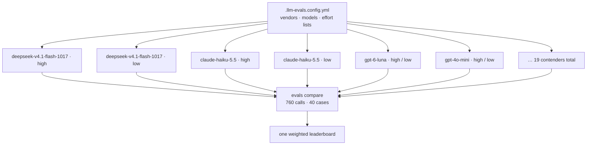
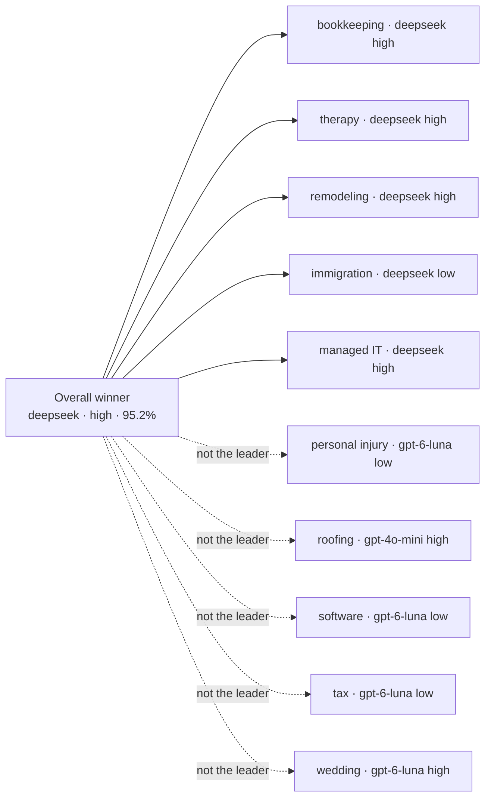
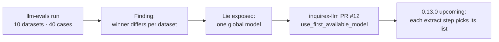
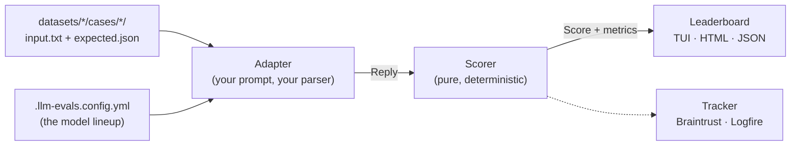

Here is what a real lead typed into a tax-preparation intake form:

> *"Got married in June, haven't figured out how we're filing yet. There's an IRS letter somewhere in a kitchen drawer I haven't opened. I also deliver groceries on weekends."*

Only one fact in that paragraph is clear: the weekend side gig. A model read it anyway and set `filing_status` to `married_jointly`.

Helpful. Wrong. The form then skipped the filing-status question and treated a guess as settled. That is the failure I care about most, and it is invisible if you only eyeball a few outputs.


I built [**llm-evals**](https://github.com/kigster/llm-evals) so I would stop writing `scripts/eval.rb` for the fourth time. It is a Ruby CLI for multi-dataset, multi-case evaluation suites. Compare models, efforts, temperatures. Rank them by one weighted score that balances accuracy, hallucinations, errors, latency, and cost. On [RubyGems](https://rubygems.org/gems/llm-evals) as of writing: 0.5.0. Two commands: `evals` and `llm-evals`.

```bash
gem install llm-evals
```

Home-made pasta tastes better because you chose the flour. Home-made evals taste better because you chose the weights, the cases, and the failure modes that matter to *your* product. Store-bought leaderboards cannot taste your soup.

## Evals are unit tests for probabilistic software

A unit test asks: given this input, does my code return exactly this output? An eval asks a softer question: given representative inputs, *how often* and *how well* does the model produce what I expect? You cannot assert equality against a probability distribution. You can score it. Score the same cases every time, and you can finally measure what a prompt tweak, a temperature change, or a model swap actually did.

The scorer decides what "good" means. The eval makes the comparison honest and repeatable.

Background I keep recommending:

- [AI Evals: Everything You Need to Know](https://hamel.dev/blog/posts/evals-faq/) by Hamel Husain
- [Demystifying Evals for AI Agents](https://www.anthropic.com/research/demystifying-evals-for-ai-agents) from Anthropic
- [Eval-Driven System Design](https://developers.openai.com/cookbook/examples/partners/eval_driven_system_design/receipt_inspection) from OpenAI

## The problem that started it: Qualified.At

The gem grew out of [Qualified.At](https://qualified.at), which I [wrote about when it launched](/2026/07/29/qualified-at-is-live.html). A business builds an intake form, embeds it, and visitors answer questions before anyone picks up the phone. The forms use the [Inquirex](https://github.com/inquirex) gems. Many start with a free-text box: *tell us about your situation*. An LLM reads that paragraph and extracts structured answers, so a 20- or 30-question form can shrink to a few follow-ups.

Here is the extraction step from the [tax preparation demo](https://qualified.at/demos/tax-preparation), copied from the suite's `dsl.rb`:

```ruby
extract :understanding do
  from :situation
  prompt "Extract the taxpayer's situation from their description. Only fill a " \
         "field when the text genuinely supports it — leave anything the writer " \
         "did not mention unset rather than guessing. ..."
  schema filing_status: { type: :enum,
                         values: %w[single married_jointly married_separately head_of_household] },
    dependents: :integer,
    self_employed: :boolean,
    rental_properties: :integer,
    sold_investments: :boolean,
    owns_business_entity: :boolean,
    multi_state: :boolean,
    irs_letter: :boolean
  transition to: :heard_you
end
```

And here is what that lead typed (the `vague` case):

> Honestly, this year was a blur and I've been avoiding thinking about taxes. I got married in June, so I assume that changes things, though we haven't talked about how we're filing. I also picked up a side gig doing grocery deliveries through one of those apps on weekends, which I'm told counts as being self-employed. Somewhere in a kitchen drawer there's a letter from the IRS that came in August that I haven't been brave enough to open. We rent our apartment, if that matters. I don't really know what else you need from me, so please just tell me what to bring.

The correct extraction is **not** "married filing jointly". They got married. They said they have not decided how to file. The right answer is:

```json
{
  "filing_status": null,
  "dependents": null,
  "self_employed": true,
  "rental_properties": null,
  "sold_investments": null,
  "owns_business_entity": null,
  "multi_state": null,
  "irs_letter": true
}
```

Two answers, six honest `null`s. A model that "helpfully" fills in `married_jointly` has invented a fact. On this case, `openai/gpt-4o-mini` scored 78.8% and the diagnostics named the hallucination: expected null, got `married_jointly`. `deepseek/deepseek-v4.1-flash-1017` at high effort scored 100% with empty diagnostics.

So the product question became: **which model captures the most answers, assigns them correctly, avoids hallucinations, and does not miss details**, while staying cheap and fast? A lead who waits 30 seconds for the next question is a lead who closes the tab. At 1,000 leads, $0.0002 per call is twenty cents. $0.50 per call is five hundred dollars.

## The Qualified.At suite

Qualified.At ships ten demo businesses: bookkeeping, couples therapy, home remodeling, immigration law, managed IT, personal injury, roofing, software development, tax preparation, and wedding photography. Each one became a dataset. Each dataset has four case variants:

| Variant    | What the lead wrote                                                       |
| ---------- | ------------------------------------------------------------------------- |
| `complete` | rambles, but answers every field                                          |
| `vague`    | hedged and incomplete; about half the fields go unanswered                |
| `partial`  | clear prose that answers some fields and explicitly defers the rest      |
| `estimate` | a complex description aimed at the fields that drive the price estimate   |

That is 10 datasets × 4 variants = 40 cases on disk:

```text
evals/
  .llm-evals.config.yml
  eval_helper.rb
  datasets/09-tax-preparation/
    dsl.rb                       # the demo flow, verbatim
    schema.rb                    # its extract step's schema; `evals verify` fails on drift
    cases/vague/input.txt
    cases/vague/expected.json
    ...
```

The `dsl.rb` and `schema.rb` files are copies of the production flow. A spec fails the moment they drift apart. An eval that quietly tests last month's schema is worse than no eval.

The adapter runs the same prompts production would. From `evals/eval_helper.rb`:

```ruby
LLM::Evals.configure do |c|
  c.suite "qualified-at-extract", root: __dir__, env_files: [ "../.env" ],
    description: "Which model turns a lead's free text into the answers an extract step declares."
  c.cases "datasets/*/cases/**/input.txt"
  c.adapter QualifiedAt::Evals::Extract::Adapter.new
  c.scorer Inquirex::LLM::Evals::Scorer.new
end
```

### Scoring: not all mistakes are equal

Every schema field ends in one of five outcomes. Each is worth a fixed share of the point (from `Inquirex::LLM::Evals::FieldScore`):

| Outcome        | Worth | When                                                               |
| -------------- | ----- | ------------------------------------------------------------------ |
| `correct`      | 1.0   | what the text says, as the schema spells it                        |
| `missed`       | 0.2   | the text answers it and the reply left it empty                    |
| `hallucinated` | 0.15  | the text never answers it, and the reply answered anyway           |
| `incorrect`    | 0.1   | an allowed value, the wrong one                                    |
| `invalid`      | 0     | a value the schema does not allow: off the list, wrong type, not JSON |

Missing a field is the least bad mistake, because the form just asks the question again. Hallucinating is worse, because the form now believes something the lead never said. Returning garbage is worst. On top of the per-field `score`, the scorer reports `exact` (every field correct), `hallucinated_rate`, and `invalid_rate`.

## One weighted score, or: which one do I ship?

Here is the thing that bit me. The report had a dozen sortable columns: accuracy, exact match, hallucination rate, errors, latency, cost, tokens. Sort by accuracy and an expensive, slow model wins. Sort by cost and a model that hallucinates wins. Sort by primary score and you crow a token hog. None of those columns answered the question I actually had, which was *which one should I ship?*

So llm-evals lets you say what matters, in YAML, and folds it into one column called `wscore`. This is the `weighted_score` section from Qualified.At's `.llm-evals.config.yml`:

```yaml
weighted_score:
  weights:
    # Positive metrics (higher is better)
    exact:              10 # Exact contributes high number
    score:               5 # This is a score computed in other ways
    # Negative metrics (lower value is better)
    latency:            -5 # Latency is important, but relatively less than others
    cost:               -5 # Same with the cost
    time:               -3 # latency contributes relatively low comparatively
    errors:             -8 # and any errors contribute quite a bit to the total
    hallucinated_rate:  -6 # Hallucinations are bad, and are penalized
    invalid_rate:       -8 # invalid_rate is an error, so heavy penalty
```

A positive weight means higher is better. A negative weight means lower is better. Raw weights are hard to reason about, though, so the `llm-evals` CLI ships a subcommand that does the math for you. I called it `weights`, which is not my most imaginative work. Run `evals weights` and it reads your `.llm-evals.config.yml`, then prints each column's direction and its real share of the final score:


> [!NOTE]
> Yes, that is a [Starship](https://starship.rs) prompt, and yes, people always ask. Here is a small present: my [`which-starship` gist](https://gist.github.com/kigster/ee667e080423c24c2a92d2de53cd9a48) is a ZSH script that downloads and installs the `starship` binary for you. It then opens a two-step menu where you scroll through every Starship preset and pick a color palette for the presets that support one.

Here is what it prints for the Qualified.At config:


Read that table as a product brief. Exact alone is 20% of the score: I want every field right, not almost right. Errors and invalid together are 32%: a broken reply is worse than a slow one. Hallucinations are 12%. Cost is only 10%. Latency is 10%. Wall time is 6%. That is not a universal truth. That is what *this* intake product cares about.

The formula is deliberately boring:

```text
wscore = Σ(|weight| × goodness) / Σ|weight|
```

Each metric's goodness is its value, or `1 - value` under a negative weight. `cost` and `time` go on a log scale between the cheapest and most expensive contender in the table, so each doubling costs the same penalty, no matter how absurd the priciest model is. Errors come straight off the top: 20 points for the first, 25 for two, and so on.

The weights are opinions, and that is the point. They force you to write down the trade-off you were going to make in your head anyway.

## The results

Settings multiply into contenders. A model listed with `effort: [low, high]` becomes two experiments. Ten models, most at both efforts, temperature fixed at 0.1: **19 configurations**, not ten models. `evals compare` made 760 calls. 751 were scored, 9 failed, and the whole run cost **$1.11**.




A few things jumped out:

- **The winner overall was `deepseek/deepseek-v4.1-flash-1017` at high effort**: 95.2% weighted, 98.5% primary score, all 40 cases, zero errors, about a cent for the lot.
- **`claude-haiku-5.5` at low effort was right behind it** at 93.8% and had the best primary score in the table: 98.8%.
- **More effort is not more accuracy.** Haiku at *high* effort wrote 16,788 output tokens against 10,249 at low, and scored slightly *lower* on both primary and weighted score. For extraction, thinking harder mostly meant paying more to second-guess itself.
- **A great primary score can still lose.** `typesafe/jev-router` scored 97.3% on accuracy, yet finished at 81.0% weighted. It also wrote 33,931 output tokens, more than any other contender, and the weights care about that.

### Every dataset crowned its own winner

DeepSeek won the tournament. It did not win every match. Here is each dataset's leader from the same run (model, effort, weighted score):

| Dataset | Winner | Effort | wscore |
| ------- | ------ | ------ | ------ |
| 01-bookkeeping-cfo | `deepseek/deepseek-v4.1-flash-1017` | high | 99.7% |
| 02-couples-family-therapy | `deepseek/deepseek-v4.1-flash-1017` | high | 99.9% |
| 03-home-remodeling | `deepseek/deepseek-v4.1-flash-1017` | high | 100.0% |
| 04-immigration-law | `deepseek/deepseek-v4.1-flash-1017` | low | 98.7% |
| 05-managed-it-services | `deepseek/deepseek-v4.1-flash-1017` | high | 99.2% |
| 06-personal-injury-law | `openai/gpt-6-luna` | low | 91.2% |
| 07-roofing-restoration | `openai/gpt-4o-mini` | high | 92.5% |
| 08-software-development | `openai/gpt-6-luna` | low | 91.6% |
| 09-tax-preparation | `openai/gpt-6-luna` | low | 96.9% |
| 10-wedding-photography | `openai/gpt-6-luna` | high | 95.6% |

Five datasets go to DeepSeek. Four go to `gpt-6-luna`. One goes to `gpt-4o-mini`. That last one is the story I want to sit with.




Same run. Same weights. Five datasets agree with the global crown. Five do not. The dashed edges are the whole point of per-dataset standings.

### Roofing: the cheap model wins

Hail on Saturday finished a tired roof. Original architectural shingles from 1998. Water dripping into an upstairs closet. A bucket under it all week. Insurance adjuster coming Thursday. Steep pitch; nobody is strolling around up there without a harness. The homeowner wants a full tear-off, not a patch.


The expected extraction:

```json
{
  "project_scope": "full_replacement",
  "stories": "two",
  "roof_pitch": "steep",
  "material": "architectural",
  "roof_age": "over_20",
  "leaking_now": true,
  "storm_damage": true,
  "filing_insurance": true,
  "timeline": "emergency"
}
```

On this dataset, the leader is `openai/gpt-4o-mini` at high effort, at **92.5%**. The overall champion, DeepSeek at high, sits sixth at **90.6%**.


Tax tells the same kind of story from the other direction. `gpt-6-luna` at low effort leads at 96.9%. DeepSeek at high drops to 87.8%.


This is the part I find genuinely important. **There is no single best model. There is a best model for this task, with these weights, on these cases.** If Qualified.At only did tax intake, I would ship a different model than the one that wins across all ten businesses. If it only did roofing, I would ship `gpt-4o-mini`. Without per-dataset standings, I would never have known. And it would be wrong to wire DeepSeek into every DSL `extract` step just because it won the global table.

The headline finding from the whole exercise: small, fast, cheap models land within a couple of points of each other at the top, at roughly a cent per 40 extractions. For turning a lead's first paragraph into structured answers, paying frontier-model prices buys you very little.

## The gem learned from the scoreboard

The evals did not stop at a blog post. They changed the product.



Once every dataset had its own winner, a single global `provider` and `*_model` became a lie we were telling ourselves. A tax flow wants the tax winner. A roofing flow wants the roofing winner. One Ruby process serves many flows. So [inquirex-llm PR #12](https://github.com/inquirex/inquirex-llm/pull/12) introduces prioritized model selection. It ships in **inquirex-llm 0.13.0** (upcoming release).

The host configures which vendors it may use and which models it prefers. Each LLM step may name its own ordered list. The gem picks the first model this process can actually reach:

```ruby
Inquirex::LLM.configure do |c|
  c.llm_vendors_priority        = %i[openrouter openai anthropic typesafe]
  c.llm_models_priority         = %w[deepseek/deepseek-v4.1-flash anthropic/claude-haiku-5.5]
  c.dsl_can_reprioritize        = true
  c.dsl_can_use_unlisted_models = true
end.ensure_provider_models!
```

And on a specific extract step:

```ruby
extract :understanding do
  from :situation
  prompt "Extract the taxpayer's situation from their description. Only fill a " \
         "field when the text genuinely supports it — leave anything the writer " \
         "did not mention unset rather than guessing."
  schema filing_status: { type: :enum,
                         values: %w[single married_jointly married_separately head_of_household] },
    dependents: :integer,
    self_employed: :boolean,
    rental_properties: :integer,
    sold_investments: :boolean,
    owns_business_entity: :boolean,
    multi_state: :boolean,
    irs_letter: :boolean
  use_first_available_model "openai/gpt-6-luna",
                            "deepseek/deepseek-v4.1-flash-1017",
                            "anthropic/claude-haiku-5.5"
  transition to: :heard_you
end
```

Evals revealed the winners. The DSL gained a way to use them. That is the loop I want: measure, then change the product, not measure and shrug.

## One day: evals as a feature

Imagine this as a premium Qualified.At offering. A business pastes about ten versions of what their leads would type into the first text box: the complete ramble, the vague hedge, the partial deferral, the estimate-heavy pitch. `llm-evals` runs those cases against many models and efforts, with *their* weights, and returns the best model for *their* form.

Not a global champion. Their champion. The same report you saw above, scoped to their schema and their prose. That is still a vision, not a shipped feature. The machinery already exists in the suite that produced these numbers.

## How the gem is shaped

You write two small classes. The gem does everything else.



- The **adapter** runs one case against one model and returns a `Reply`. It owns everything the model sees and everything done to its answer. In Qualified.At, it calls the same prompt builder and the same parser production uses, so the scores reflect production rather than a lab version of it.
- The **scorer** turns a case and a reply into a `Score` with whatever metrics you declare. It never calls anything.

The gem handles case discovery, the model lineup, providers (OpenRouter by default, through [RubyLLM](https://rubyllm.com/)), rate limits, retries, thread pools, progress bars, the leaderboard, an HTML report, and optional reporting to [Braintrust](https://braintrust.ai) or [Logfire](https://pydantic.dev/logfire). Some of the design came from [Pydantic Evals](https://pydantic.dev/logfire/evals).

A few decisions I am stubborn about:

- **A wrong answer is a 0. A network error is an error, not a 0.** Your model did not answer wrongly because OpenRouter returned a 503.
- **A model the suite cannot ask is refused by name, not scored.** If your suite sends chat prompts and the lineup lists a typed-question model, you get `typesafe/jev-latest refused: needs typesafe; this suite produces prompt` before anything runs.
- **Settings multiply.** `effort: [low, high]` with `temperature: [0.0, 0.7]` becomes four contenders for that model. You are not comparing models; you are comparing *configurations*.
- **No lock-in.** A local JSON log is always written. Any HTML report can be re-rendered from it later with `evals render`, with no model calls.

## Try it

The repository ships two example suites that use fake models, so they need no API keys and no network:

```bash
git clone https://github.com/kigster/llm-evals.git
cd llm-evals
bundle install
just examples
```

For your own project, copy the toy suite's `evals/` folder, swap in your adapter and scorer, list real models under `openrouter:` in `.llm-evals.config.yml`, set `OPENROUTER_API_KEY`, and:

```bash
evals cases        # list the cases; calls nothing
evals verify       # offline checks of inputs, expected answers, adapter and scorer
evals compare -n   # show the experiment matrix; calls nothing
evals compare      # run it, and open the report
```

> [!TIP]
> Run `evals compare -n` before every paid run. It prints the full experiment matrix, so you find out that you accidentally multiplied three efforts by three temperatures by twelve models *before* OpenRouter does.

The gem is MIT-licensed, and the [README](https://github.com/kigster/llm-evals) covers writing providers (there is a full Ollama example) and trackers (there is a W&B Weave sketch). Issues and pull requests are very welcome.

## Final Thoughts

There is no best model. There is only the best model for a given task, at a given price, with a given tolerance for being confidently wrong. DeepSeek won my suite overall, and it still lost three datasets to gpt-6-luna and one to gpt-4o-mini. If I had picked one winner and wired it into every `extract` step, I would have shipped worse answers to a third of my customers and called it a decision.

The leaderboard is not the point. The point is that the question "which model should we use?" stops being an argument and becomes a command you can rerun next week, when the next model drops and the prices move again. Write the cases your product cannot afford to get wrong. Choose weights that say what you actually care about. Then let the numbers settle it.

And if you are about to write `scripts/eval.rb` for the fourth time, please don't. I already did. Home-made tastes better when someone else rolled the dough.
