Here is a design problem I have been chewing on. A web application stores tax documents. They are about as sensitive as consumer data gets: names, Social Security numbers, income, bank accounts, all on one page.

The requirements fit on an index card:

1. The owner sees their documents decrypted in their account.
1. The owner can grant another user (their tax preparer) read-only or read-write access, scoped to a set of documents such as one tax year.
1. The owner can withdraw that access.
1. Once a return is filed, its documents become immutable, and both the owner and the preparer who filed it can decrypt them forever.
1. Next year the owner may pick a different preparer, who then gets access to everything.

And one threat that shapes everything else:

> An attacker gains remote code execution on the Rails API server. That server talks to the database holding every client's data. The attacker should leave with statistics and nothing else.

That last line is the whole post. Most "encrypted at rest" designs fail it, and the reason they fail it tells you where the keys need to live.

## The one question that sorts every design

Forget algorithms for a minute. AES-256-GCM is fine. Everybody uses it. Nobody gets breached because their cipher was weak.

Ask this instead: **whose hands can turn ciphertext into plaintext?**

If the answer includes "the API server, on request", then an attacker running code on the API server can do the same thing, at the same speed, for every customer. Encryption has been reduced to a compliance checkbox.

If you remember one picture from this post, make it this one:

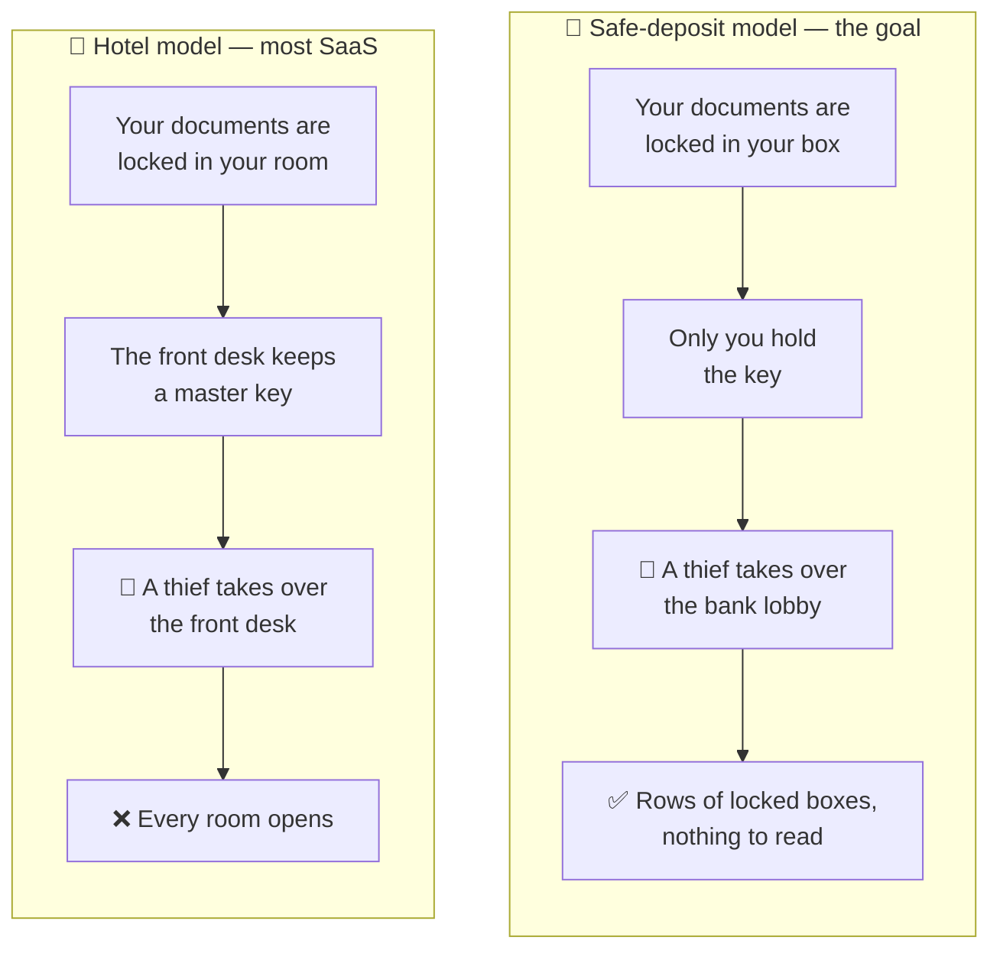

Both buildings can truthfully say "everything is locked". Only one of them survives the front desk being taken over.

So every method below gets judged on the same line: after RCE on Rails, what can the attacker decrypt?

## Method 1: server-side envelope encryption with a KMS

The default, and what most SaaS products mean by "encrypted".

- Each document gets a random data encryption key (DEK).
- The DEK is wrapped by a key held in a KMS (AWS KMS, GCP KMS, Vault Transit).
- Rails calls `kms:Decrypt` to unwrap a DEK, decrypts the document, and serves it.
- Sharing is a row in a `permissions` table.

It is easy, it supports server-side search and OCR, and recovery is trivial because users hold no keys.

It also fails the threat model outright. The Rails server's IAM role is allowed to call `kms:Decrypt`. The attacker is now the Rails server. They loop over every row and ask the KMS politely. Access control is an `if` statement in a process they own.

The attacker never steals a key. They do not need to:

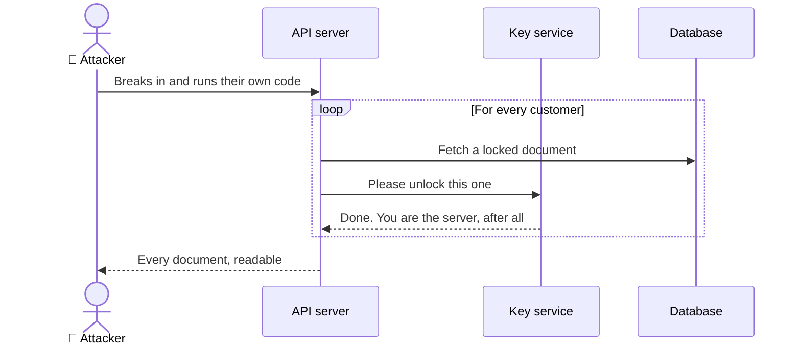

What the KMS does buy you: stolen backups and SQL injection dumps are useless, the master key cannot be exfiltrated, and every decrypt is logged, so you can at least count what was read. That is damage assessment, not prevention.

## Method 2: keys derived from the user's password

The classic password-manager approach.

- Client derives a key from the password with Argon2id.
- That key wraps the user's document keys.
- The server stores only ciphertext and never sees the password-derived key.

Now the server genuinely cannot decrypt, which is the property we want. The costs:

- Security is capped by the password. A stolen database invites offline guessing.
- Passwords get phished, and here a phished password is a decrypted vault.
- A symmetric key alone gives you no way to share. You need public keys for that, which brings us to the next method.

## Method 3: per-document keys, wrapped per user

This is the scheme I was first told about, and it is the right core. Nearly every end-to-end encrypted product is a variation of it.

- Each user has a keypair. The public key sits on the server. The private key never leaves the user's devices unwrapped.
- Each document has its own DEK.
- To give a user access, wrap the DEK with that user's **public** key and store the wrapped copy.

```text
documents         id, owner_id, ciphertext_ref
document_keys     document_id, user_id, wrapped_dek, role
user_keys         user_id, public_key, wrapped_private_key
```

Granting access needs only the recipient's public key, so the owner can do it while the preparer is offline. Revoking is deleting a row. The server stores many wrapped keys and can open none of them.

In plain terms: lock the document once, then put a copy of its key in a sealed envelope for each person allowed to read it.

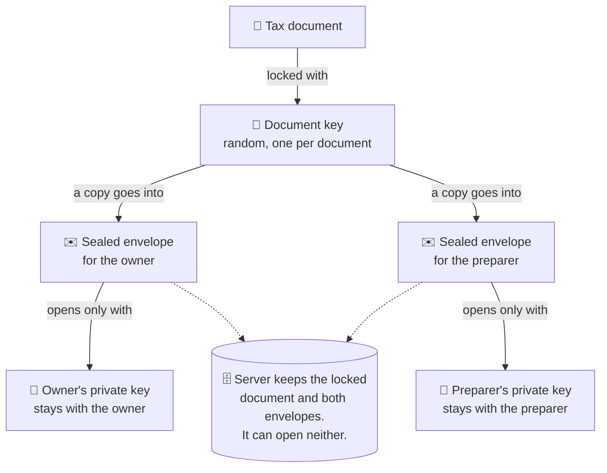

Two things to notice:

- One wrapped DEK per document per user gets chatty. Sharing 400 documents means 400 wraps. A key hierarchy (below) fixes that.
- The scheme says nothing about where the private key lives. That is the hard part, and it is where passkeys come in.

## Method 4: passkeys as the key to the key

A common misunderstanding first: **a passkey cannot encrypt anything.** A WebAuthn credential is a signing key. It proves you are you. It will not wrap a DEK.

What changed is the WebAuthn **PRF extension**. During a passkey ceremony, the authenticator will compute an HMAC over a salt you provide, using a secret bound to that credential, and hand back 32 bytes. Same passkey plus same salt gives the same 32 bytes, every time, and the server never sees them.

Those 32 bytes become a key-encryption key:

```js
const assertion = await navigator.credentials.get({
  publicKey: {
    challenge,
    rpId: "vault.example.ai",
    extensions: { prf: { eval: { first: vaultSalt } } },
  },
});

const secret = assertion.getClientExtensionResults().prf.results.first;
const ikm = await crypto.subtle.importKey("raw", secret, "HKDF", false, ["deriveKey"]);
const kek = await crypto.subtle.deriveKey(
  { name: "HKDF", hash: "SHA-256", salt: new Uint8Array(), info: new TextEncoder().encode("vault-kek-v1") },
  ikm,
  { name: "AES-GCM", length: 256 },
  false, // not extractable
  ["wrapKey", "unwrapKey"],
);
```

### What the passkey-derived key should wrap

The tempting answer is "the document's symmetric key, directly". It is close, and one step short:

| The KEK wraps | Works for | The catch |
| --- | --- | --- |
| Every document key, directly | one user, one passkey | Each passkey yields a different PRF output, so a second passkey or a recovery code means re-wrapping every document. Delete the passkey and every document is gone. |
| One **owner root key**, which wraps the document keys | the owner, on any number of passkeys | One small wrap per passkey. This is the one to build. |
| A **private key** | receiving documents other people share with you | Needed only for sharing, see below. |

So the KEK wraps two things: the owner's symmetric root key, and the private key used to receive shares. For the owner reading their own documents the chain is symmetric from end to end: fingerprint, then passkey, then PRF output, then KEK, then root key, then document keys. No public-key cryptography is involved, which turns out to matter later.

Sharing is the one job a PRF cannot do. The preparer's PRF output exists only on the preparer's device, so the owner has nothing to wrap a key *to*. That is why Method 3's public keys stay in the design.

If you use [SimpleWebAuthn](https://simplewebauthn.dev/docs/advanced/prf), know that it deliberately stops at the plumbing: it carries the PRF salt as base64url between server and browser and leaves the cryptography to you. Its docs open with "Proceed with extreme caution" and warn that a user who deletes their passkey "will lose all access to their information". Take that seriously and plan recovery before launch, not after. Also plan for an extra tap at signup, because many authenticators only report that PRF is enabled when the passkey is created and hand over the actual bytes on the next sign-in.

The owner's path, without the acronyms:

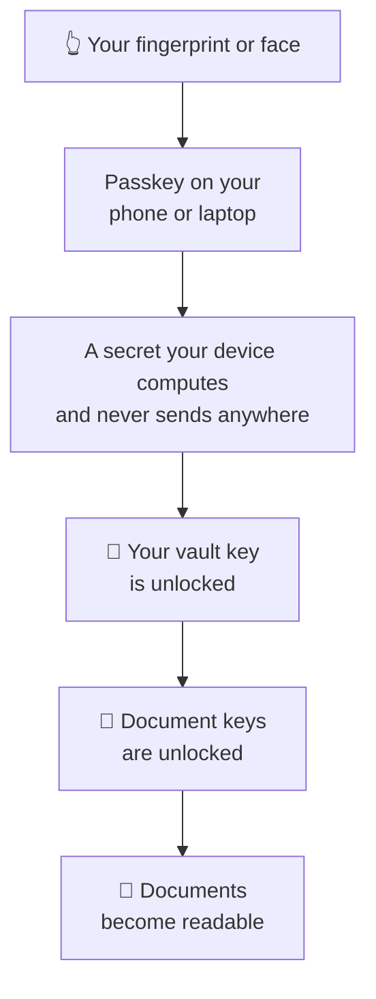

Every step happens on the customer's own device. The server watches none of it.

Compared with a password, this is phishing-resistant, backed by hardware, and has nothing to brute-force offline. The catch is that PRF support depends on the browser and the passkey provider, so test your matrix and decide what happens to a user whose authenticator lacks it.

## Method 5: two origins, two passkeys, one dedicated encryption keypair

Method 4 has a soft spot. If the login passkey also unlocks the vault, then every script running on the application's origin is one function call away from the vault key. The application origin is large: Rails views, a JavaScript bundle with hundreds of dependencies, analytics, a support widget. And in our threat model, **the attacker controls the server that serves that JavaScript.**

So split it:

- **`app.example.ai`** issues a passkey for login. Relying party ID `app.example.ai`. It authenticates and nothing more.
- **`vault.example.ai`** is visited by redirect during signup. It issues a **second** passkey with relying party ID `vault.example.ai` and PRF enabled, then generates the owner's root key, a dedicated encryption keypair for receiving shares, and a signing keypair, all in the browser. The root key and the private halves are wrapped with the PRF-derived KEK. The public halves are published.

What the customer experiences at signup is two fingerprint taps instead of one:

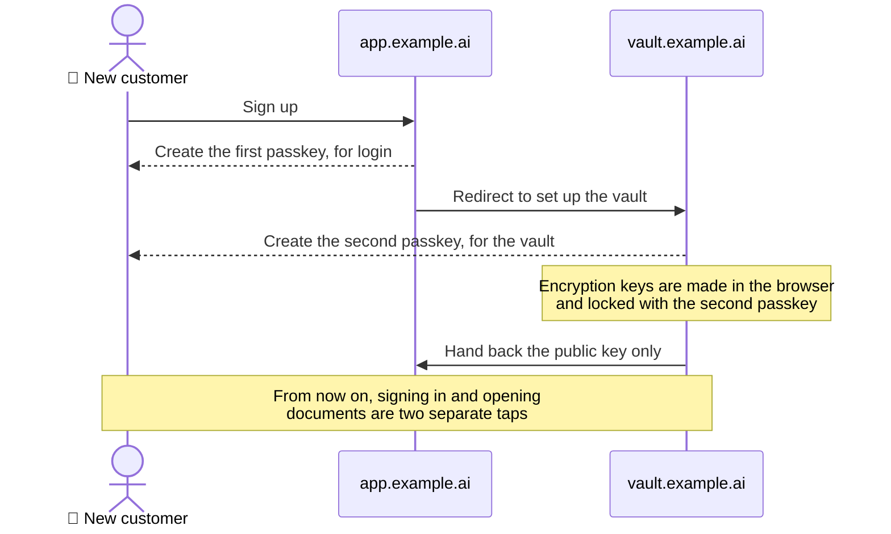

And here is how the pieces sit once the account exists:

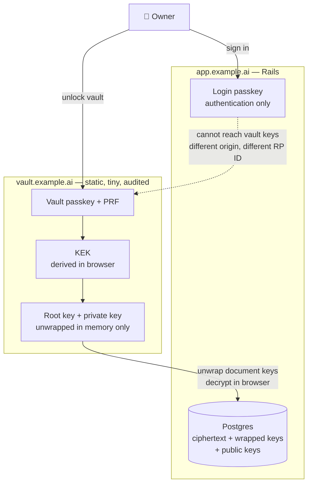

Why this is more than ceremony:

- **The browser enforces the wall.** A page on `app.example.ai` cannot request a credential scoped to `vault.example.ai`, and cannot read that origin's memory or storage. Compromised application JavaScript gets no path to the PRF output.
- **The relying party IDs must be the full subdomains.** Register either passkey against `example.ai` and both subdomains can use it, which quietly deletes the isolation.
- **The vault origin can be boring.** A few hundred lines of dependency-free JavaScript, a strict Content Security Policy, served from static hosting with its own deploy pipeline, on infrastructure Rails cannot write to. RCE on Rails does not let the attacker change one byte of it.
- **Login and decryption become separate events.** A stolen session cookie on the app is not a decrypted vault.

How the app gets plaintext onto the screen: it embeds the vault as a cross-origin iframe, and the vault renders the decrypted document inside its own frame. The app never holds plaintext or keys. It is more work than passing bytes back with `postMessage`, and it is the version that survives a compromised app bundle.

The honest limit of any browser-based scheme: whoever serves the vault's JavaScript can serve a malicious version. Method 5 does not remove that trust. It shrinks it from "the whole application and its supply chain" to "one small static site that changes twice a year".

## Method 6: a recipient chain, the way SOPS does it

My own tool, [sopsy](https://sopsy-cli.dev), solves the same problem for a different payload. It wraps [SOPS](https://github.com/getsops/sops) and [age](https://github.com/FiloSottile/age) so a team can commit encrypted secrets to git, where a list of people is allowed to decrypt and that list can change. Could the same chain work here?

First, a correction to something I had half-believed myself. Adding a person does **not** re-encrypt the files. In SOPS:

- Each file has one random data key. The values are encrypted with it.
- The data key is wrapped once per recipient, and the wrapped copies live in the file's metadata.
- **Adding** a recipient (`sops updatekeys`) adds one more wrapped copy of the same data key. Every file is rewritten, but only its metadata. The ciphertext of the values does not change.
- **Removing** a recipient properly means generating a new data key and re-encrypting the values (`sops rotate`), because the person removed may have kept the old data key.

Letting someone in is cheap. Locking someone out is the expensive direction:

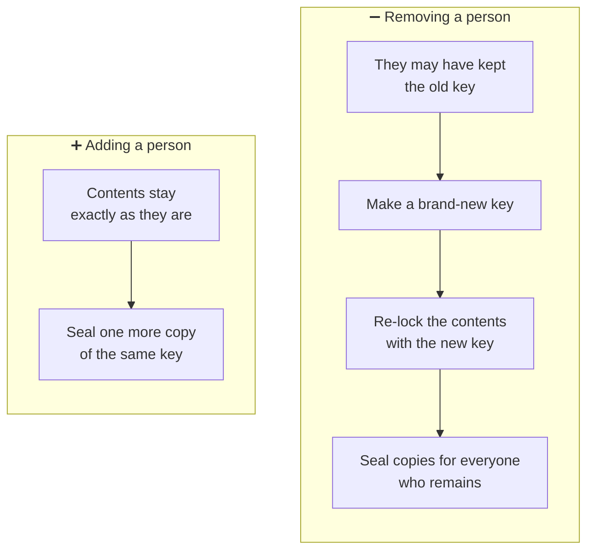

Look at that again and it is Method 3. A SOPS file is a document, the data key is a DEK, and the recipients stanza is the `document_keys` table stored inline. So yes, the chain applies. It already is the design.

Three differences matter when moving it from a git repo to a SaaS:

| | SOPS / sopsy | Document vault |
| --- | --- | --- |
| Recipient set | one list for the whole repo | per owner, per tax year |
| Who may change it | anyone who can merge a pull request | the owner only, enforced by signature |
| Audit trail | git history | needs an append-only, signed grant log |

What is worth stealing from sopsy is the workflow: a newcomer publishes a public key, an existing member vouches for it out-of-band, and only then does anything get wrapped for them. Keep that. It matters more than it looks, as the attack section shows.

## The key hierarchy that fits the tax rules

Wrapping every document for every reader is wasteful, and "this year only" versus "everything" wants structure. Three levels do it:

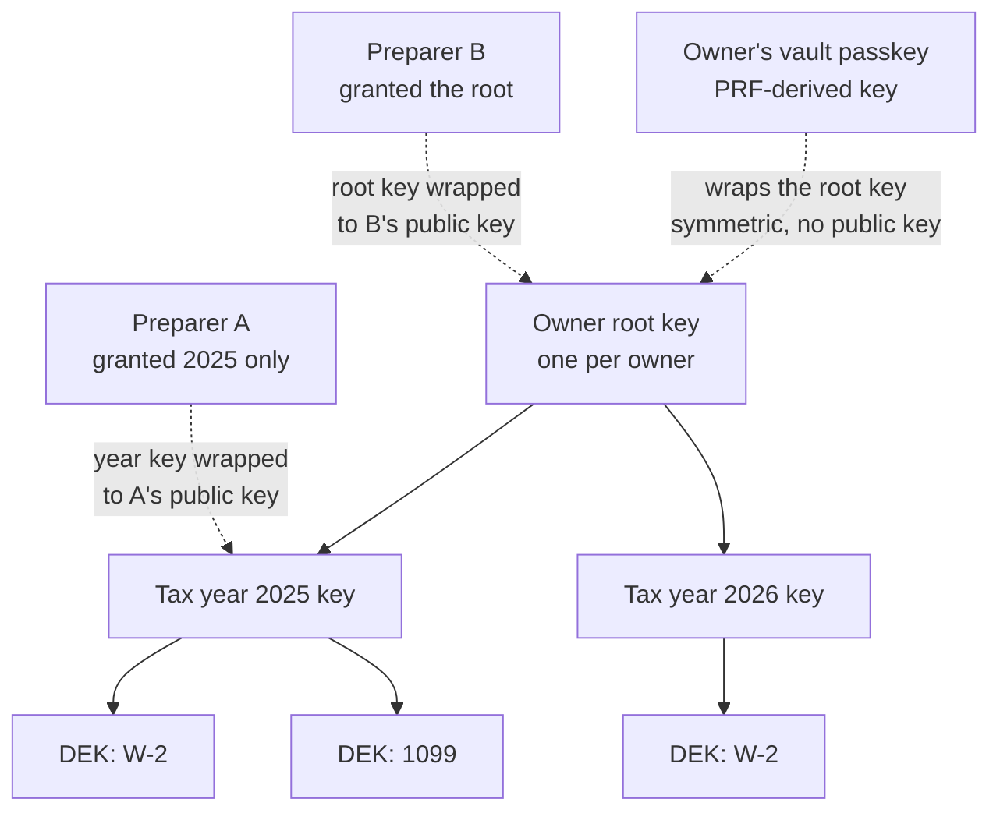

- **The owner's own access:** the root key is wrapped once per vault passkey, and once more under the recovery code. Adding a passkey never touches a document.
- **Share one year:** wrap that year's key to the preparer's public key. One operation, however many documents.
- **New preparer next year, sees everything:** wrap the root key to them. One operation.
- **Revoke:** delete the wrapped copy and rotate the affected key, so documents uploaded from now on are out of the revoked party's reach. Be honest in the product copy: nobody can un-read a document. Revocation controls the future.
- **Filed means frozen:** at filing, the owner signs a manifest of the year's ciphertext hashes and the year key is never rotated again. The filing preparer re-wraps that year key into their own keyring, so it stops being a grant the owner can pull. That matches reality: a preparer has record-retention duties and already holds a copy of what they filed.

The life of one tax year, as the customer sees it:

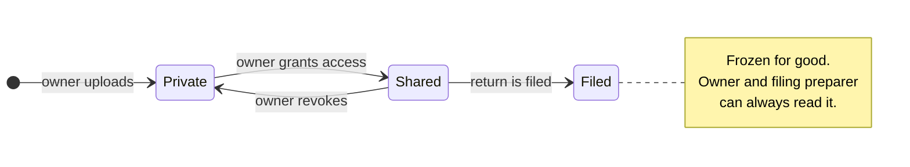

### Read-only versus read-write

Encryption alone cannot express read-only. Anyone holding a symmetric key can produce valid ciphertext with it.

Write access has to be a **signature**:

- Every user has a signing keypair next to their encryption keypair.
- Every document version is signed by its author.
- The owner signs the grant itself: "this public key may write to tax year 2026".
- Clients reject any version whose author lacks a signed write grant.

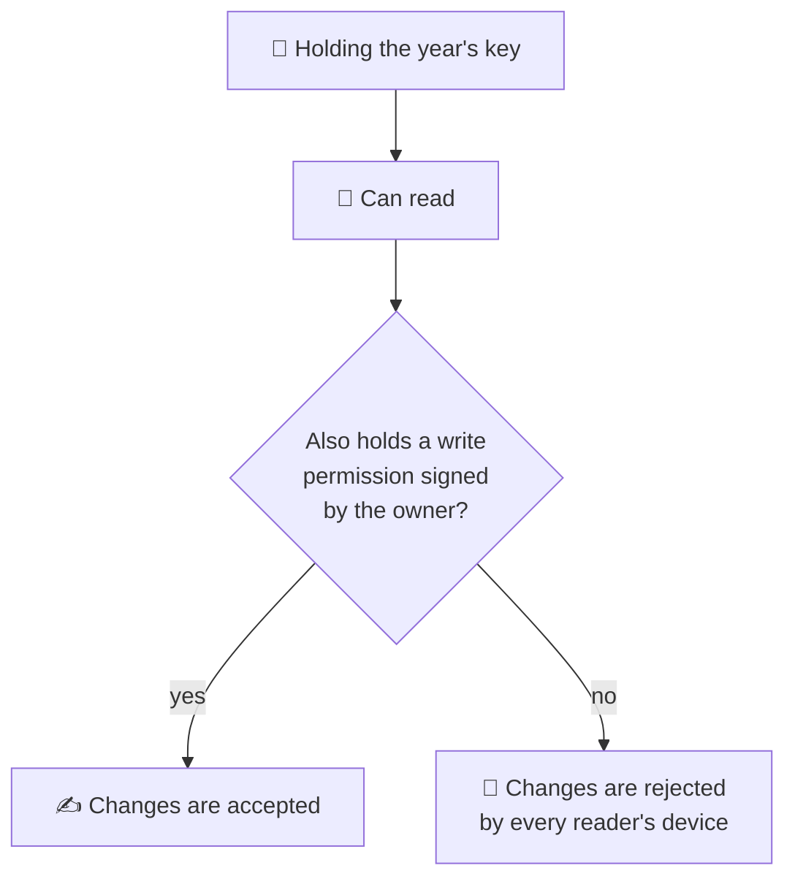

The server enforces the same rule, but it is no longer the only thing enforcing it. An attacker on the server can refuse or delete writes. They cannot forge one that a client will accept.

## What the attacker gets with RCE on Rails

With Methods 3 through 6 in place, the database gives up:

- ciphertext and wrapped keys, none of which the server can open
- public keys
- metadata: who shares with whom, document counts, sizes, timestamps
- filenames and document types, **unless you encrypt those too** (do)

That is the "statistics" outcome today. There is one caveat about tomorrow, covered in the quantum section below.

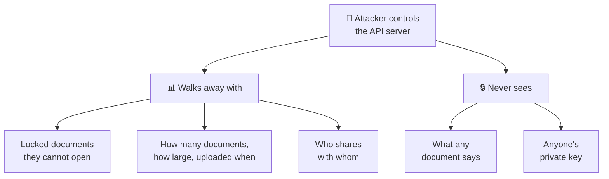

Three active attacks remain, and they are the real design work:

1. **Key substitution.** The server is the public key directory. The attacker swaps the preparer's public key for their own, and the owner's browser faithfully wraps the year key to the attacker. This is the most important attack in the whole design. Counter it the sopsy way: the owner verifies a fingerprint or a short code out-of-band on first share, then signs the preparer's key, and clients only trust owner-signed keys afterward.
1. **Malicious JavaScript.** Covered above. It is why the vault origin exists and why Rails must not be able to deploy to it.
1. **Deletion and rollback.** The attacker can destroy data or serve an older version. That is an availability and integrity problem, handled with backups and signed manifests. It leaks nothing.

The first one deserves a picture. Here is the swap, and the thirty-second habit that defeats it:


## The price: recovery and server-side features

Nothing here is free.

- **Lose every passkey, lose every document.** There is no "forgot my password" email, because nobody else has the key. Wrap the private key under several things: a second passkey, a synced passkey, a printed recovery code. Any server-side escrow you add for convenience brings back the exact weakness you were removing.
- **The server cannot read the documents.** No server-side OCR, no full-text search, no automatic W-2 field extraction in a background job. For a tax product that hurts. Either do the extraction in the browser, or move it into the one place designed for this:

**Method 7 (the escape hatch): an attested enclave.** Run the decrypt-and-extract code inside a confidential-computing enclave (AWS Nitro Enclaves and friends). The KMS key policy releases keys only to an enclave whose code measurement matches a known hash. Rails can hand the enclave ciphertext and get structured fields back, but RCE on Rails cannot make the KMS release a key, because Rails is not the enclave. You are trusting the cloud provider's attestation and your own enclave build, which is a much smaller target than a Rails monolith.

Google Cloud's version is [Confidential Space](https://docs.cloud.google.com/docs/security/confidential-space), and its documentation describes exactly the property we are after. The workload operator "typically has full administrative privileges to the project" and still "doesn't have access to the data or the results". The enclave proves what code it is running, receives a token saying so, and the key's access policy admits only that token. SSH into the enclave image is disabled. Read the limits as carefully as the promise: supply-chain attacks on the image's own dependencies are out of scope, somebody has to actually review the image, and the image must not contain secrets.

## So does putting the wrapped key in a KMS help?

Suppose each owner has one symmetric key. Could its wrapped form live "in the KMS", and is that more secure?

A small correction on the mechanics: a KMS does not store your wrapped keys. It holds the **wrapping** key and performs wrap and unwrap operations. The wrapped blob sits in your own database either way.

Whether it helps depends on a single fact: **who is allowed to call unwrap?**

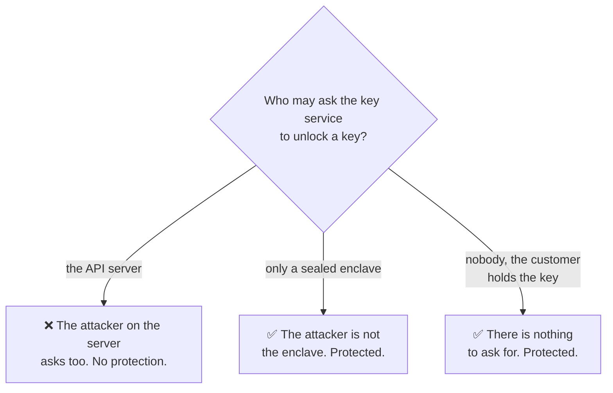

| Who can call `Decrypt` | RCE on Rails yields | Verdict |
| --- | --- | --- |
| The Rails server role | every owner's key, one API call each | Method 1 again. Good audit log, no protection |
| Only an attested enclave (Nitro Enclaves, Confidential Space) | nothing | Real protection, and server-side processing still works |
| Nobody: the wrapping key comes from the user's passkey | nothing | Real protection, and the KMS is not on this path at all |

So: a KMS raises the bar against database theft, leaked backups, and insiders with database access. Against the threat this post is about, it does nothing if Rails holds the permission to unwrap. An attacker on the server does not need to steal the key. They borrow the server's authority to use it.

A KMS still earns a place as a second layer. Wrap the already-user-wrapped blobs once more with a KMS key and a plain database dump becomes worthless twice over. Just do not count it as the control that stops RCE.

## What your cloud provider's controls do and do not cover

Reading Google Cloud's [security overview](https://docs.cloud.google.com/docs/security/overview/whitepaper), its [baseline security checklist](https://docs.cloud.google.com/docs/security/gcmvsp) and the [Assured Workloads](https://docs.cloud.google.com/assured-workloads/docs) documentation with this post's question in mind is clarifying. The controls are real, and nearly all of them guard against a different thief.

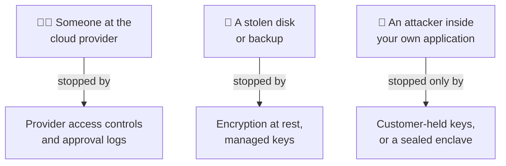

| Control | Who it keeps out | Takes your API server off the list? |
| --- | --- | --- |
| Default encryption at rest | whoever steals a disk. The provider owns and manages these keys | No |
| Customer-managed keys (Cloud KMS, HSM, external key manager) | the provider, and you gain a kill switch | No. Your server is the authorized caller |
| Access Transparency, Access Approval, Key Access Justifications | provider personnel, with a log and a veto | No |
| Assured Workloads | data leaving a region, support staff outside a jurisdiction | No |
| Confidential Space | your own operators and a compromised host | Yes, for the workload inside it |

Two notes for a tax product specifically. Assured Workloads lists a data boundary for IRS Publication 1075, so if that regime applies to you, the residency and personnel controls come pre-packaged. And none of this is an argument against turning these controls on. A compliance boundary and a break-in boundary are different things, and you want both.

## The quantum caveat in the sharing path

In March 2026 Google [set 2029 as its deadline](https://blog.google/innovation-and-ai/technology/safety-security/cryptography-migration-timeline/) for migrating to post-quantum cryptography, with one line that lands directly on this design: "The threat to encryption is relevant today." The reason is store-now-decrypt-later. An attacker copies ciphertext today and waits for a machine that can open it.

Now look again at what our attacker walks away with: locked documents and sealed envelopes. Tax records stay sensitive for decades, so "they cannot open them" needs an honest "yet".

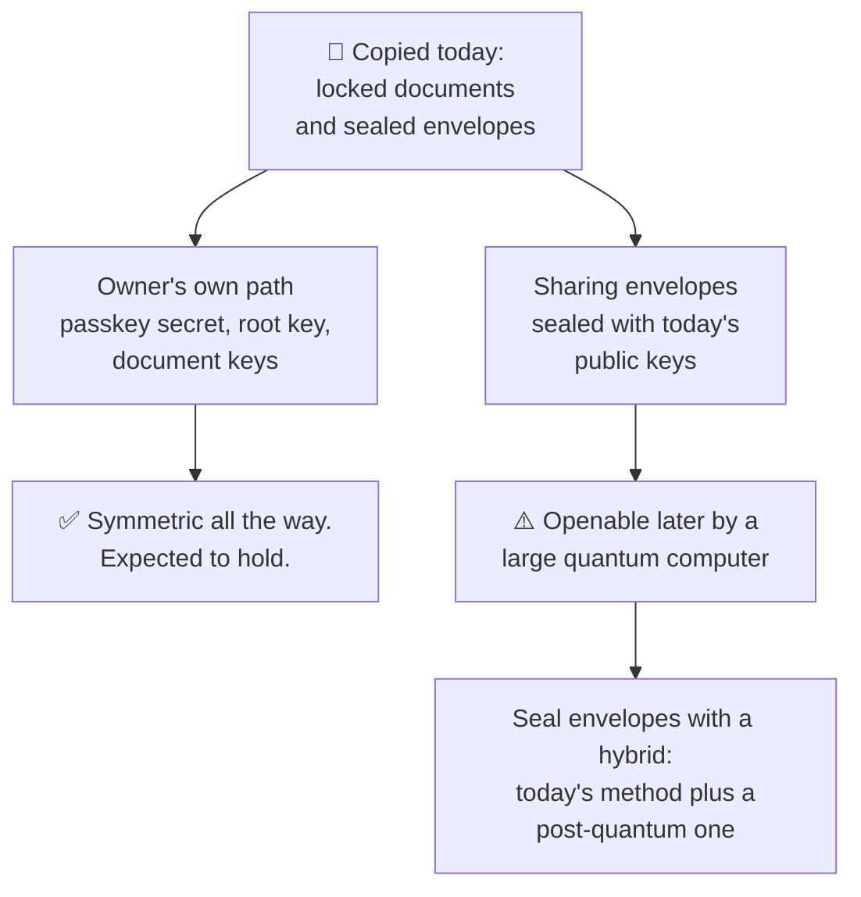

The damage is narrower than it first sounds, and the reason is the choice made back in Method 4:

- **The owner's path is symmetric end to end.** PRF output, HKDF, AES-256. Symmetric cryptography at these sizes is generally considered to hold up against quantum attack. An owner who never shares has no harvestable public-key envelope at all.
- **The sharing envelopes are the exposed part.** A year key wrapped to a preparer's elliptic-curve public key is exactly what a future quantum computer opens. Seal those with a hybrid of X25519 and ML-KEM, so an attacker has to break both.
- **Do it from day one.** Re-wrapping later protects what is in your database then. It does nothing for a copy taken before.
- **Label every wrapped key** with its algorithm and version, so the next migration is a background job and not a redesign.

Signatures are the less urgent half. In Google's words they are "a future threat": a forged signature only matters once the machine exists. Two places to keep an eye on:

- **Login passkeys.** SimpleWebAuthn already accepts [ML-DSA passkeys](https://simplewebauthn.dev/docs/advanced/server/pqc-ml-dsa-support) at registration, on Node 24.7 or newer. The public keys are 20 to 40 times larger than P-256, so check the column type first. This changes how a passkey signs in. It has no effect on PRF or on anything encrypted.
- **Owner-signed grants and filing manifests.** These are meant to be believed for years, so store them in a form that can be re-signed under a newer algorithm.

## Side by side

| Method | RCE on Rails reads documents? | Sharing | Revocation | Recovery | Server-side processing |
| --- | --- | --- | --- | --- | --- |
| 1. KMS envelope, server decrypts | **Yes, all of them** | ACL row | instant | trivial | yes |
| 2. Password-derived key | No, but offline guessing | needs Method 3 | n/a | password reset loses data | no |
| 3. Per-document DEK, wrapped per user | No | wrap to public key | delete + rotate | depends on key storage | no |
| 4. Passkey PRF unlocks the key | No, unless app JS is tampered | as Method 3 | as Method 3 | extra passkeys, recovery code | no |
| 5. Split origins, dedicated vault keypair | No, even with app JS tampered | as Method 3 | as Method 3 | extra passkeys, recovery code | no |
| 6. Recipient chain (SOPS-style) | No | add recipient, re-wrap | remove + rotate | break-glass key | no |
| 7. Attested enclave + KMS | No | ACL inside enclave | instant | operator-managed | **yes** |

## What I would build

- Method 5 for the keys: login passkey on `app.example.ai`, vault passkey with PRF on `vault.example.ai`.
- The vault passkey's PRF output wraps the owner's symmetric root key directly, once per passkey and once under a recovery code.
- Method 3 for the storage and the sharing, with the root, year, document hierarchy, and hybrid post-quantum envelopes for every share.
- The sopsy habits for the membership: out-of-band verification, owner-signed recipient keys, an append-only signed grant log.
- Method 7 only if the product truly needs the server to read documents, and then for that one job.
- A KMS wrap around everything at rest, as a second layer and never the first.

If you are making this call for your own product, two questions get you most of the way:

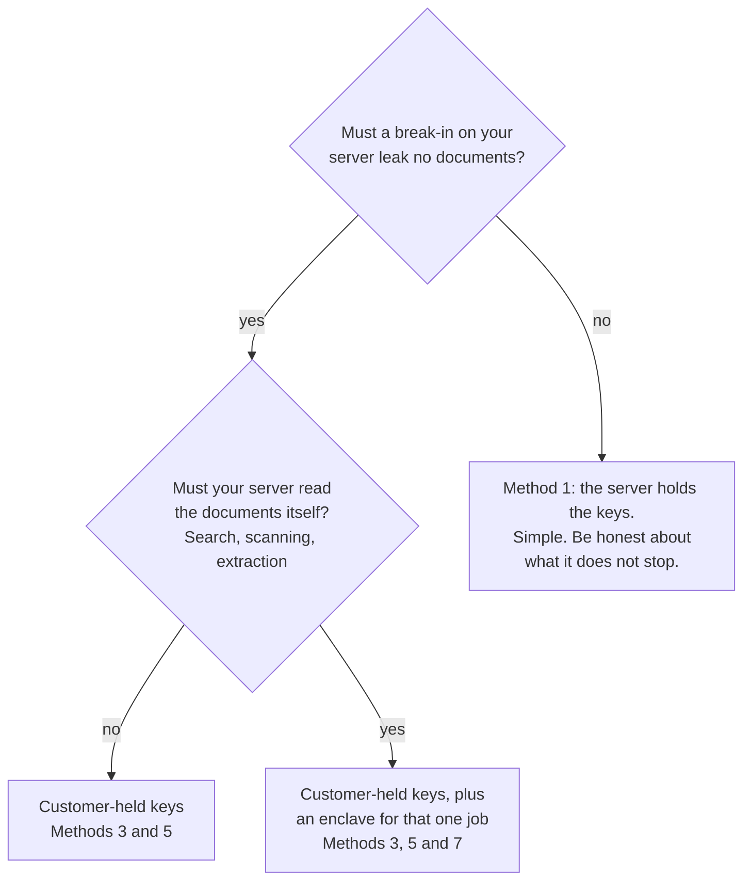

The through-line is the question from the top. Do not ask whether the data is encrypted. Ask whose hands can decrypt it, and make sure your API server is not on the list.
