> [!IMPORTANT]
> Just think about it. Mathematics problems that were unsolved for 500 years — ✔ solved. Numerous zero days discovered in BSD (arguably the most secure OS we thought we have) — ✔ discovered in numbers.
>
> We are living through the time of **enormous change**, and it affects (or will affect) everyone. Hopefully, it won't end in our extinction. But the AI already discovered so many zero-day exploits in system software, which generations of top programmers reviewed over and over and saw nothing. How does one expect to protect one's cloud infrastructure when a a zero day exploits are dropping like rain?

______________________________________________________________________

**_I built several e-commerce stores from scratch in my career (Infectious, ModCloth), two marketplaces (Blurb.com & Wanelo.com), a crypto exchange (Coinbase), and I saw major security incidents and zero day exploits targeting engineer next to me, so I got front and center seat to the entire drama. And I can tell with a certainty that if your data is of any value, at all, to anyone... then you'll want to read this post and think about what it is can you do, if and when a North Korean hacker running stolen Mythos gains root on your app server, because someone will, so pray that it's not tomorrow._**

______________________________________________________________________

## Encrypted At Rest — Sleep Soundly At Night?

Most SaaS products that say "we keep our data encrypted at rest" will hand every client's data to an attacker who gets code execution rights on their Web or API server, assuming that server needs to access the same data in a decrypted form. The cipher holds. The key service holds. The attacker never steals a key. They just ask the server to decrypt, and since the server is allowed to, it does.

> __So the fix is one sentence long. Take your APP servers off the list of things that can decrypt. And please turst me, I know that it's not that simple.__

So what can we do? Half of your servers them have a public IP for whatever reason. As do databases.

— Well, that's the first thing you gotta fix. And quickly.

Your infrastructure must be locked down like a fort. [Google](https://docs.cloud.google.com/static/docs/security/overview/resources/google_security_wp.pdf) and [AWS](https://aws.amazon.com/security/culture-of-security/) have plenty of security guides on how to do that. HashiCorp also has a [whitepaper](https://www.datocms-assets.com/2885/1749757084-the-next-generation-of-cloud-security-whitepaper.pdf) on the subject.

All of this is useful and good. But I'd like to take a fresh look at SaaS security, and see how we can diversify the responsibility for keeping your data safe.

So then let's jump in, eh?

## Let's Build an Accounting Software, in 2026.

We'll have clients, and accountants. Clients will be uploading many sensitive documents, and accountants must be able to read them. Does anyone else need to read them? Perhaps a background job. So now that we know our exposure points, we can design a system that satisfies these constraints.

> But what we are **not** going to assume, is that a hacker will never gain access to your app servers. Because they will. For example, Rails just a few months ago had a ["Arbitrary File Read and Possible Remote Code Execution in Ruby on Rails"](https://www.rapid7.com/blog/post/etr-kindarails2shell-cve-2026-66066-critical-arbitrary-file-read-and-possible-remote-code-execution-in-ruby-on-rails/) vulnerability. NextJS — a popular ReactJS backend, had [similar remote execution vulnerability](https://nextjs.org/blog/CVE-2025-66478) at the end of last year, and a [bunch more recently](https://digital.nhs.uk/cyber-alerts/2026/cc-4873). Rust had vulnerabilities [as well](https://www.sentinelone.com/vulnerability-database/cve-2024-24576/?utm_source=https%3A%2F%2Fwww.google.com%2F&utm_medium=organic-search) just as any language or framework you dig deep enough into.

So if none of these frameworks are safe, and knowing that far from everybody will upgade to the fixed version the same day, _**we should assume break-ins are going to happen not as an exception, but as a rule**_.

Therefore this post is dedicated to finding a solution that allows you to run sensitive data SasS, and not go to Jail when hackers make your servers their bitch.

Back to our hypothetical application: a client still has to read their own files, share a year of them with their accountant, and take that access back. I went through seven designs to get there. The one I would build uses two passkeys, a second website a few hundred lines long, and a habit I borrowed from my own secrets tool. It also costs you the "forgot my password" email and server-side search, which is why most products skip it.


## Problem Definition

Here is the design problem I have been chewing on for longer than I would like to admit. A web application stores sensitive financial documents. Bank statements, payroll reports, signed contracts, scans of government IDs. One leaked page is enough to steal an identity.

The requirements fit on an index card:

______________________________________________________________________

1. The client sees their own documents decrypted in their account.
1. The client can give another user, say their accountant or bookkeeper, read-only or read-write access to a set of documents such as one fiscal year.
1. The client can take that access back.
1. Once the accountant closes the books for a year, that year's documents become immutable. The client and the accountant who closed the year can decrypt them forever.
1. Next year the client may hire a different accountant, who then gets access to everything.

______________________________________________________________________

And one threat that shapes everything else:

> **An attacker gains remote code execution on a Rails API or APP server (if you are not a Rails fan, pick your poison: Django, whatever). That server talks to the database holding every client's data. The attacker should leave with statistics and nothing else.**

Most designs pass the five requirements and fail the blockquote. How they fail tells you where the keys have to live.

## One question sorts every design

Skip the algorithm debate. AES-256-GCM is fine. Everybody uses it, and nobody gets breached because their cipher was weak.

Ask this instead. Whose hands can turn ciphertext into plaintext?

If the answer includes "the API server, on request", then an attacker running code on the API server can do the same thing, at the same speed, for every client. Your encryption is now a compliance checkbox.

I think of it as a hotel versus the safe-deposit room at a bank.

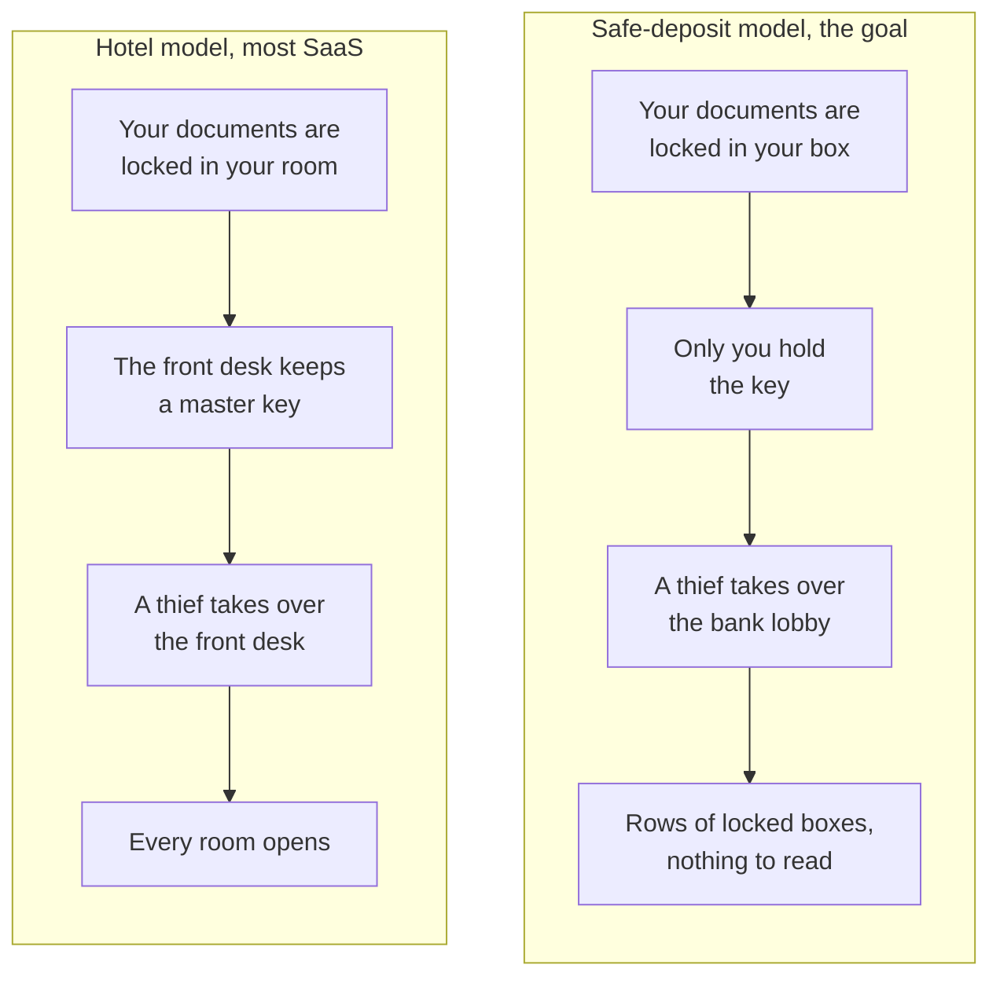

Both buildings can say "everything is locked" and be telling the truth. Only one of them survives a thief behind the front desk.

Every method below gets the same test. After RCE on Rails, what can the attacker decrypt?

## Method 1:<br /> the server decrypts with a KMS

This is the default, and it is what most SaaS products mean by "encrypted".

- Each document gets a random data encryption key, or DEK.
- A key held in a KMS wraps the DEK. AWS KMS, GCP KMS and Vault Transit all work this way.
- Rails calls `kms:Decrypt` to unwrap a DEK, decrypts the document, and serves it.
- Sharing is a row in a `permissions` table.

It is easy to build. Server-side search and OCR work. Recovery is trivial because users hold no keys.

It also fails the threat model outright. The Rails server's IAM role may call `kms:Decrypt`, and the attacker is now the Rails server. They loop over every row and ask the KMS, which says yes every time. Your access control is an `if` statement in a process they own.

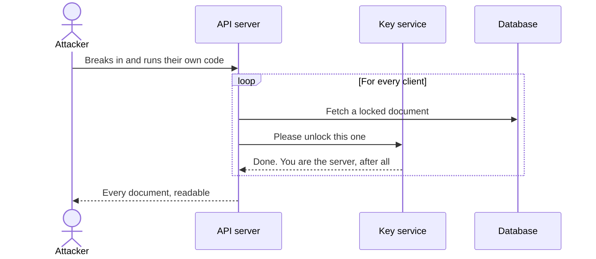

The KMS does buy you something. Stolen backups and SQL injection dumps are useless without it. Nobody can copy the master key out. And it logs every decrypt, so after the break-in you can count exactly what the attacker read. That count is the whole benefit. The break-in still happened.

## Method 2:<br /> keys derived from the user's password

The classic password-manager approach.

- The browser derives a key from the password with Argon2id.
- That key wraps the user's document keys.
- The server stores only ciphertext and never sees the password-derived key.

Now the server cannot decrypt, which is the property we want. It has three costs.

- The password caps the security. A stolen database invites offline guessing.
- People get phished, and here a phished password is a decrypted vault.
- A symmetric key gives you no way to share. Sharing needs public keys, which is the next method.

## Method 3:<br /> one key per document, wrapped once per reader

This is the scheme someone first described to me, and it is the right core. Nearly every end-to-end encrypted product is a variation of it.

- Each user has a keypair. The server stores the public key. The private key never leaves the user's devices unwrapped.
- Each document has its own DEK.
- To give a user access, wrap the DEK with that user's public key and store the wrapped copy.

```text
documents         id, owner_id, ciphertext_ref
document_keys     document_id, user_id, wrapped_dek, role
user_keys         user_id, public_key, wrapped_private_key
```

Granting access needs only the recipient's public key, so the client can share while the accountant is offline. Revoking is deleting a row. The server stores many wrapped keys and can open none of them.

In plain terms, you lock the document once, then put a copy of its key in a sealed envelope for each person allowed to read it.

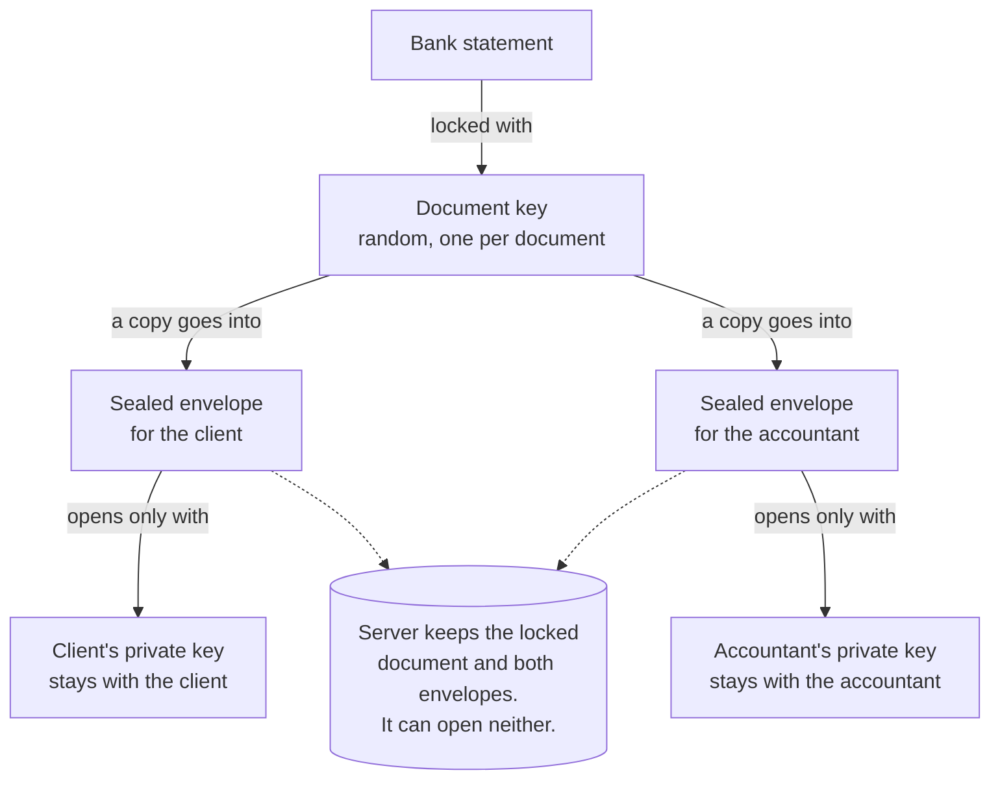

Two things to notice.

- One wrapped DEK per document per user gets chatty. Sharing 400 documents means 400 wraps. A key hierarchy, described further down, fixes that.
- The scheme says nothing about where the private key lives. That is the hard part, and it is where passkeys come in.

## Method 4:<br /> a passkey unlocks the key

First, a misunderstanding I keep running into. A passkey cannot encrypt anything. A WebAuthn credential is a signing key. It proves you are you, and it will not wrap a DEK.

What changed is the [WebAuthn PRF extension](https://www.passkeyprf.com/). During a passkey ceremony, the authenticator computes an HMAC over a salt you provide, using a secret bound to that credential, and hands back 32 bytes. The same passkey and the same salt produce the same 32 bytes every time, and the server never sees them.

Those 32 bytes become a key-encryption key, or KEK.

<details>
<summary>Show the browser code that derives the KEK</summary>

```js
const assertion = await navigator.credentials.get({
  publicKey: {
    challenge,
    rpId: "vault.example.com",
    extensions: { prf: { eval: { first: vaultSalt } } },
  },
});

const secret = assertion.getClientExtensionResults().prf.results.first;
const ikm = await crypto.subtle.importKey("raw", secret, "HKDF", false, ["deriveKey"]);
const kek = await crypto.subtle.deriveKey(
  { name: "HKDF", hash: "SHA-256", salt: new Uint8Array(), info: new TextEncoder().encode("vault-kek-v1") },
  ikm,
  { name: "AES-GCM", length: 256 },
  false, // not extractable
  ["wrapKey", "unwrapKey"],
);
```

</details>

### What the passkey-derived key should wrap

The tempting answer is "each document's key, directly". That works until the day a user adds a second passkey.

| The KEK wraps                                          | Works for                                       | The catch                                                                                                                                                           |
| ------------------------------------------------------ | ----------------------------------------------- | ------------------------------------------------------------------------------------------------------------------------------------------------------------------- |
| Every document key, directly                           | one user, one passkey                           | Each passkey yields a different PRF output, so a second passkey or a recovery code means re-wrapping every document. Delete the passkey and every document is gone. |
| One root key per client, which wraps the document keys | the client, on any number of passkeys           | One small wrap per passkey. This is the one to build.                                                                                                               |
| A private key                                          | receiving documents other people share with you | Needed only for sharing, see below.                                                                                                                                 |

So the KEK wraps two things. One is the client's symmetric root key. The other is the private key that receives shares.

When a client reads their own documents, the chain is symmetric from end to end. Fingerprint, passkey, PRF output, KEK, root key, document keys. No public-key cryptography takes part, and that pays off in the quantum section.

Sharing is the one job a PRF cannot do. The accountant's PRF output exists only on the accountant's device, so the client has nothing to wrap a key to. That is why Method 3's public keys stay in the design.

If you use [SimpleWebAuthn](https://simplewebauthn.dev/docs/advanced/prf), know that it stops at the plumbing on purpose. It carries the PRF salt as base64url between server and browser and leaves the cryptography to you. Its docs open with "Proceed with extreme caution" and warn that a user who deletes their passkey "will lose all access to their information". Believe them, and plan recovery before launch. Also plan for an extra tap at signup. Many authenticators only report that PRF is enabled when they create the passkey, and hand over the bytes on the next sign-in.

The client's path, without the acronyms:

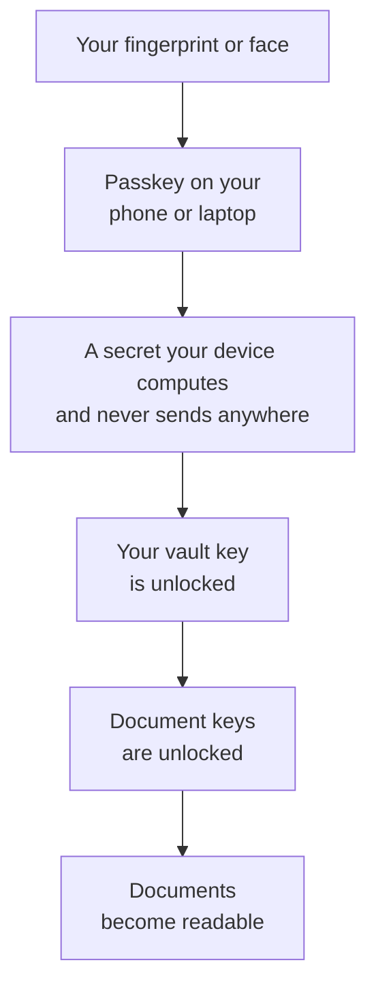

Every step happens on the client's own device. The server sees none of it.

Compared with a password, a PRF key resists phishing, lives in hardware, and gives an attacker nothing to brute-force offline. The catch is that PRF support depends on the browser and the passkey provider. Test your matrix, and decide what happens to a user whose authenticator lacks it.

## Method 5:<br /> two origins, two passkeys

Method 4 has a soft spot. If the login passkey also unlocks the vault, then every script running on the application's origin is one function call away from the vault key. That origin is big. Rails views, a JavaScript bundle with hundreds of dependencies, analytics, a support widget. And in our threat model the attacker controls the server that serves that JavaScript.

So split it.

- `app.example.com` issues a passkey for login, with relying party ID `app.example.com`. It authenticates and does nothing else.
- `vault.example.com` gets a visit by redirect during signup. It issues a second passkey with relying party ID `vault.example.com` and PRF enabled. Then, in the browser, it generates the client's root key, an encryption keypair for receiving shares, and a signing keypair. The PRF-derived KEK wraps the root key and both private halves. The vault publishes the public halves.

At signup the client taps their fingerprint twice instead of once.

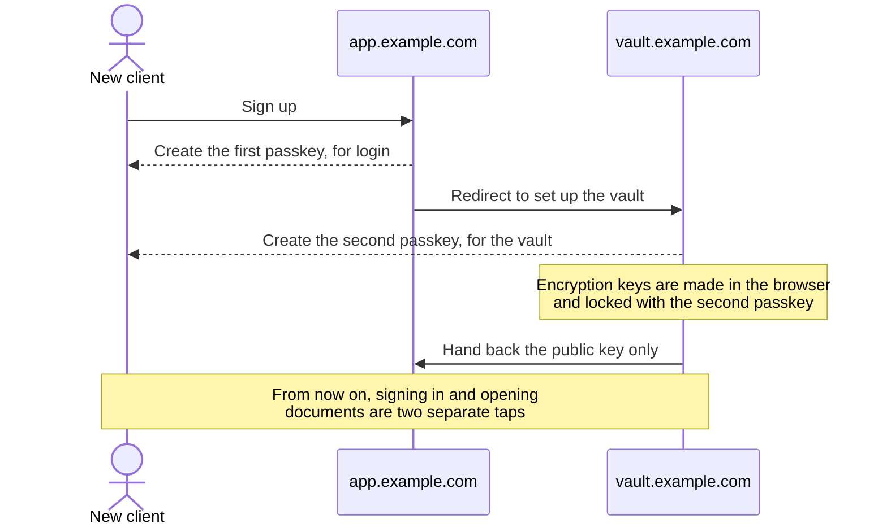

Once the account exists, the pieces sit like this:

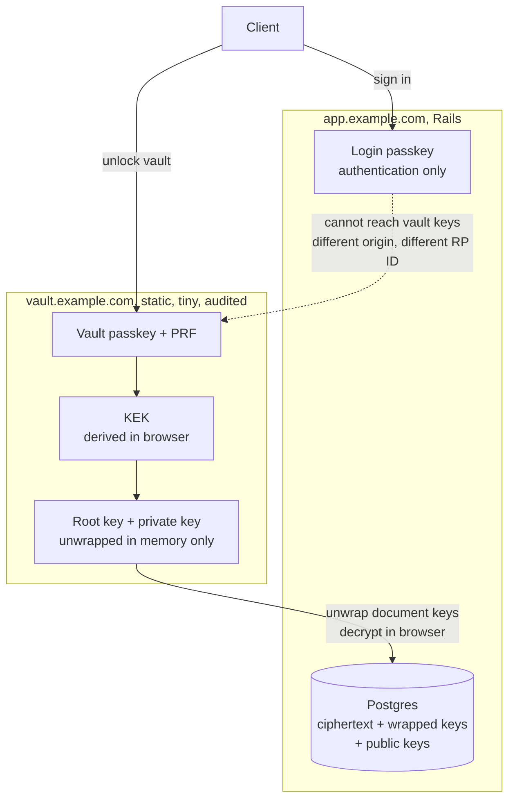

Four reasons the second tap earns its keep.

- **The browser enforces the wall.** A page on `app.example.com` cannot request a credential scoped to `vault.example.com`, and cannot read that origin's memory or storage. Compromised application JavaScript has no path to the PRF output.
- **The relying party IDs must be the full subdomains.** Register either passkey against `example.ai` and both subdomains can use it. The isolation is gone, and nothing warns you.
- **The vault origin can be boring.** A few hundred lines of dependency-free JavaScript, a strict Content Security Policy, static hosting with its own deploy pipeline, on infrastructure Rails cannot write to. RCE on Rails does not let the attacker change one byte of it.
- **Login and decryption become separate events.** A stolen session cookie on the app does not open the vault.

To put plaintext on the screen, the app embeds the vault as a cross-origin iframe, and the vault renders the decrypted document inside its own frame. The app never holds plaintext or keys. This is more work than passing bytes back with `postMessage`. It is also the version that survives a compromised app bundle.

Every browser-based scheme shares one limit. Whoever serves the vault's JavaScript can serve a malicious version. Method 5 does not remove that trust. It shrinks it from "the whole application and its supply chain" to "one small static site that changes twice a year".

## Method 6:<br /> a recipient list, the way SOPS does it

The CLI tool I published earlier this year (written in Rust) that encrypts developer secrets so you can store them in Git [sopsy](https://sopsy-cli.dev), solves the same problem for a different payload. 

It wraps [SOPS](https://github.com/getsops/sops) and [age](https://github.com/FiloSottile/age) so a team can commit encrypted secrets to git. A list of people may decrypt, and that list changes over time. Could the same chain work here?

First I had to correct something I had half-believed about my own tool. Adding a person does not re-encrypt the files. In SOPS:

- Each file has one random data key, which encrypts the values.
- SOPS wraps the data key once per recipient and stores the wrapped copies in the file's metadata.
- Adding a recipient with `sops updatekeys` adds one more wrapped copy of the same data key. SOPS rewrites every file, but only the metadata. The ciphertext of the values does not change.
- Removing a recipient properly means running `sops rotate`, which generates a new data key and re-encrypts the values. The person you removed may have kept the old data key.

Letting someone in is cheap. Locking someone out is the expensive direction.

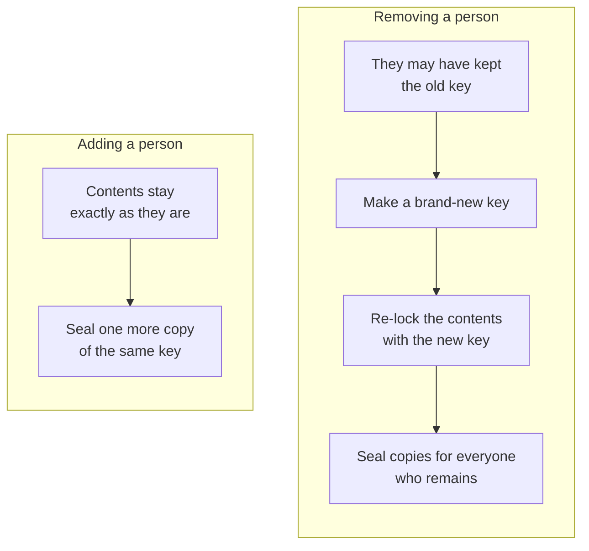

Squint and this is Method 3. A SOPS file is a document, the data key is a DEK, and the recipients stanza is the `document_keys` table stored inline. So yes, the chain applies. It already is the design.

Three things change when you move it from a git repo to a SaaS.

|                   | SOPS / sopsy                        | Document vault                         |
| ----------------- | ----------------------------------- | -------------------------------------- |
| Recipient set     | one list for the whole repo         | per client, per fiscal year            |
| Who may change it | anyone who can merge a pull request | the client only, enforced by signature |
| Audit trail       | git history                         | needs an append-only, signed grant log |

The part of sopsy worth stealing is the workflow. A newcomer publishes a public key. An existing member vouches for it out-of-band. Only then does anyone wrap anything for them. Keep that habit. The attack section shows why.

### A key hierarchy that fits how bookkeeping works

Wrapping every document for every reader is wasteful, and "this year only" versus "everything" needs structure. Three levels cover it.

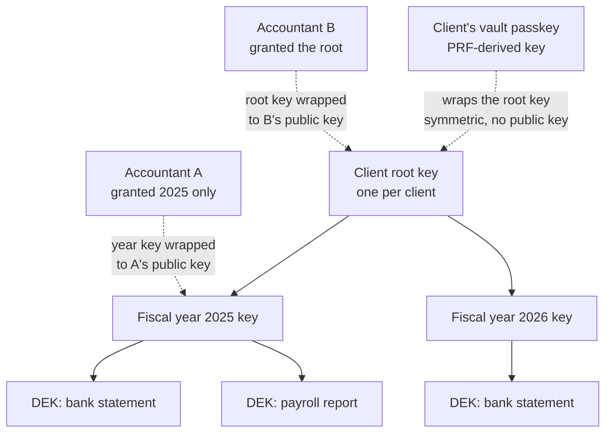

- **The client's own access.** The vault wraps the root key once per vault passkey, and once more under the recovery code. Adding a passkey never touches a document.
- **Share one year.** Wrap that year's key to the accountant's public key. One operation, however many documents.
- **New accountant next year, sees everything.** Wrap the root key to them. One operation.
- **Revoke.** Delete the wrapped copy and rotate the affected key, so documents uploaded from then on are out of the revoked party's reach. Say so plainly in the product copy. Nobody can un-read a document. Revocation controls the future.
- **Closed means frozen.** When the books close, the client signs a manifest of the year's ciphertext hashes and nobody rotates that year key again. The accountant who closed the year re-wraps the year key into their own keyring, so it stops being a grant the client can pull. That matches how the work goes. An accountant has record-retention duties and already holds a copy of what they signed off on.


The life of one fiscal year, as the client sees it:

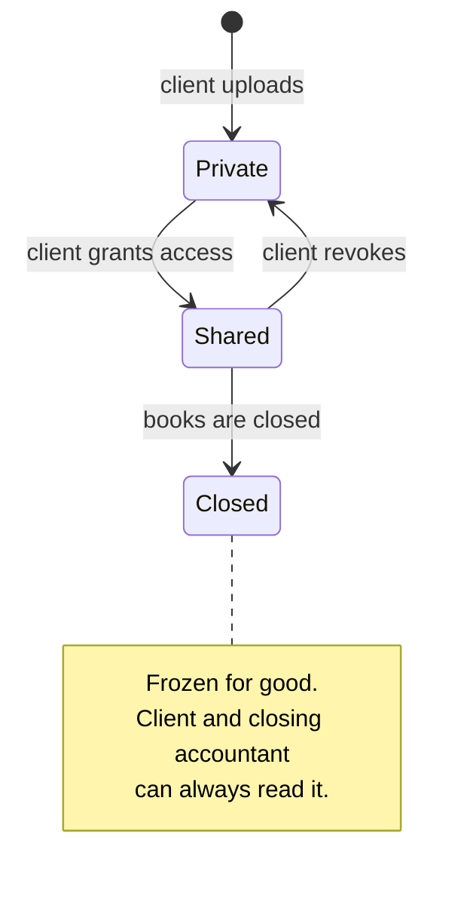

### Read-only versus read-write

Encryption alone cannot express read-only. Anyone holding a symmetric key can produce valid ciphertext with it.

Write access has to be a signature.

- Every user has a signing keypair next to their encryption keypair.
- The author signs every document version.
- The client signs the grant itself, which says "this public key may write to fiscal year 2026".
- Every reader's browser rejects any version whose author lacks a signed write grant.

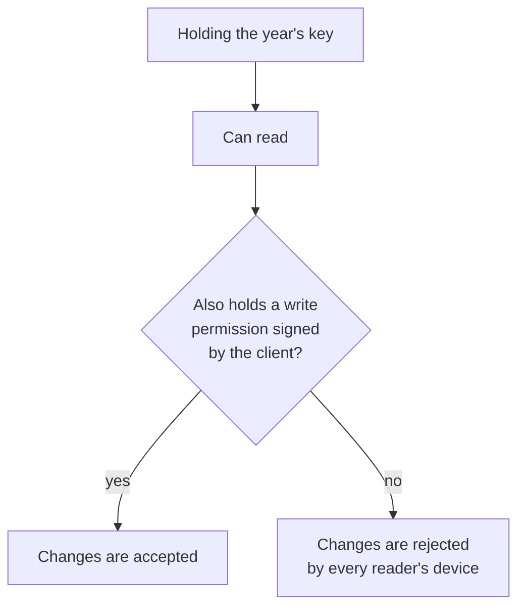

The server enforces the same rule, but it is no longer the only enforcer. An attacker on the server can refuse or delete writes. They cannot forge one that a reader's browser will accept.

### What the attacker gets with RCE on Rails

With Methods 3 through 6 in place, the database gives up:

- ciphertext and wrapped keys, none of which the server can open
- public keys
- metadata such as who shares with whom, document counts, sizes and timestamps
- filenames and document types, unless you encrypt those too. Do.

That is the "statistics" outcome today. Tomorrow has one caveat, covered in the quantum section.

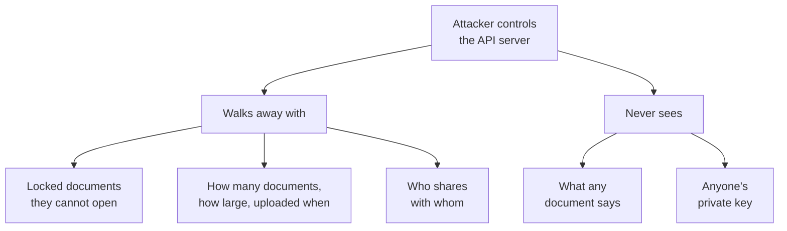

Three active attacks remain, and they are where the design work is.

1. **Key substitution.** The server is the public key directory. The attacker swaps the accountant's public key for their own, and the client's browser wraps the year key to the attacker without complaint. This is the most important attack in the whole design. Counter it the sopsy way. The client checks a fingerprint or a short code out-of-band on first share, then signs the accountant's key, and from then on browsers trust only client-signed keys.
1. **Malicious JavaScript.** Covered above. It is why the vault origin exists and why Rails must not be able to deploy to it.
1. **Deletion and rollback.** The attacker can destroy data or serve an older version. That hurts availability and integrity, and backups and signed manifests handle it. It leaks nothing.

The first one deserves a picture. Here is the swap, and the thirty-second phone call that defeats it.

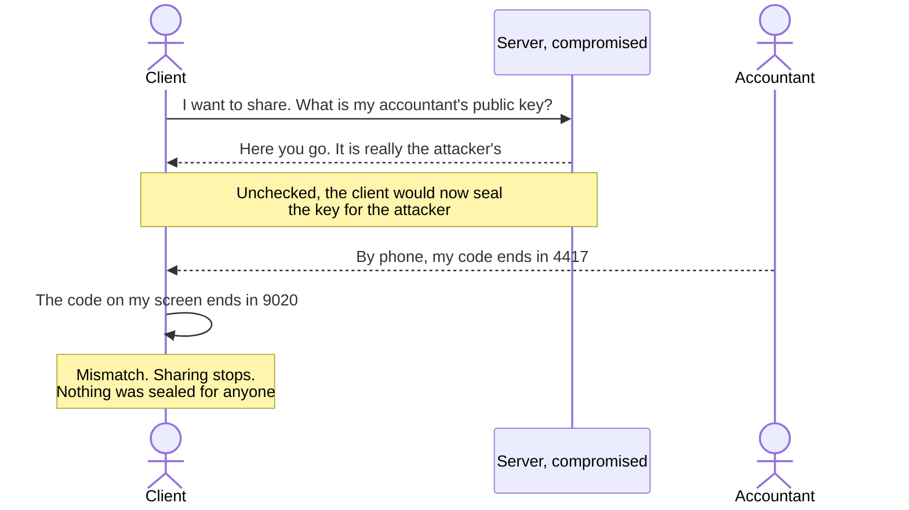

### The price

You pay for all of this in two places.

- **Lose every passkey, lose every document.** There is no "forgot my password" email, because nobody else has the key. Wrap the root key and the private key under several things. A second passkey, a synced passkey, a printed recovery code. Any server-side escrow you add for convenience brings back the weakness you removed.
- **The server cannot read the documents.** No server-side OCR, no full-text search, no background job that pulls the totals out of an invoice. For a bookkeeping product that hurts. Either do the extraction in the browser, or move it into the one place built for this.

## Method 7,<br /> the escape hatch: an attested enclave

Run the decrypt-and-extract code inside a confidential-computing enclave such as AWS Nitro Enclaves. The KMS key policy releases keys only to an enclave whose code measurement matches a known hash. Rails can hand the enclave ciphertext and get structured fields back. RCE on Rails cannot make the KMS release a key, because Rails is not the enclave. You are trusting the cloud provider's attestation and your own enclave build, and that is a much smaller target than a Rails monolith.

Google Cloud's version is [Confidential Space](https://docs.cloud.google.com/docs/security/confidential-space), and its documentation describes the property we are after. The workload operator "typically has full administrative privileges to the project" and still "doesn't have access to the data or the results". The enclave proves what code it runs, receives a token saying so, and the key's access policy admits only that token. Google disables SSH into the enclave image.

Read the limits as carefully as the promise. Supply-chain attacks on the image's own dependencies are out of scope, somebody has to review the image, and the image must not contain secrets.

### So does putting the wrapped key in a KMS help?

Suppose each client has one symmetric key. Could its wrapped form live "in the KMS", and is that more secure?

A small correction on the mechanics first. A KMS does not store your wrapped keys. It holds the wrapping key and performs wrap and unwrap operations. The wrapped blob sits in your own database either way.

Whether it helps depends on one fact. Who may call unwrap?

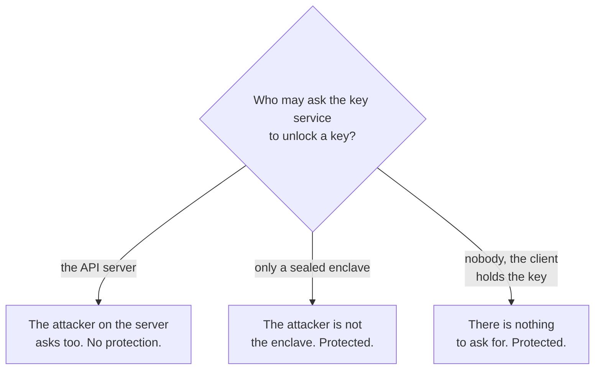

| Who can call `Decrypt`                                                 | RCE on Rails yields                   | Verdict                                                 |
| ---------------------------------------------------------------------- | ------------------------------------- | ------------------------------------------------------- |
| The Rails server role                                                  | every client's key, one API call each | Method 1 again. Good audit log, no protection           |
| Only an attested enclave, such as Nitro Enclaves or Confidential Space | nothing                               | Real protection, and server-side processing still works |
| Nobody, because the wrapping key comes from the user's passkey         | nothing                               | Real protection, and the KMS is not on this path at all |

A KMS raises the bar against database theft, leaked backups, and insiders with database access. Against the threat in this post it does nothing if Rails holds the permission to unwrap. An attacker on the server has no need to steal the key. They borrow the server's authority to use it.

A KMS still earns a place as a second layer. Wrap the already-user-wrapped blobs once more with a KMS key and a plain database dump is worthless twice over. Do not count it as the control that stops RCE.

## What your cloud provider's controls cover

I read Google Cloud's [security overview](https://docs.cloud.google.com/docs/security/overview/whitepaper), its [baseline security checklist](https://docs.cloud.google.com/docs/security/gcmvsp) and the [Assured Workloads](https://docs.cloud.google.com/assured-workloads/docs) documentation with this post's question in mind. The controls are real. Nearly all of them guard against a different thief.

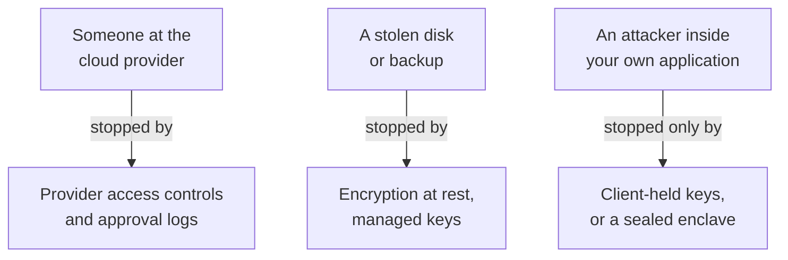

<details>
<summary>The same thing, control by control</summary>

| Control                                                                | Who it keeps out                                                | Takes your API server off the list?      |
| ---------------------------------------------------------------------- | --------------------------------------------------------------- | ---------------------------------------- |
| Default encryption at rest                                             | whoever steals a disk. The provider owns and manages these keys | No                                       |
| Customer-managed keys in Cloud KMS, an HSM, or an external key manager | the provider, and you gain a kill switch                        | No. Your server is the authorized caller |
| Access Transparency, Access Approval, Key Access Justifications        | provider personnel, with a log and a veto                       | No                                       |
| Assured Workloads                                                      | data leaving a region, support staff outside a jurisdiction     | No                                       |
| Confidential Space                                                     | your own operators and a compromised host                       | Yes, for the workload inside it          |

Assured Workloads packages residency and personnel controls for specific compliance regimes. If one of them applies to you, those controls come ready-made.

</details>

None of this is an argument against turning these controls on. A compliance boundary and a break-in boundary are different things, and you want both.

## The quantum caveat in the sharing path

In March 2026 Google [set 2029 as its deadline](https://blog.google/innovation-and-ai/technology/safety-security/cryptography-migration-timeline/) for migrating to post-quantum cryptography. One line in that announcement lands on this design: "The threat to encryption is relevant today." The reason is store-now-decrypt-later. An attacker copies ciphertext today and waits for a machine that can open it.

Look again at what our attacker walks away with. Locked documents and sealed envelopes. Financial records stay sensitive for decades, so "they cannot open them" needs a "yet".

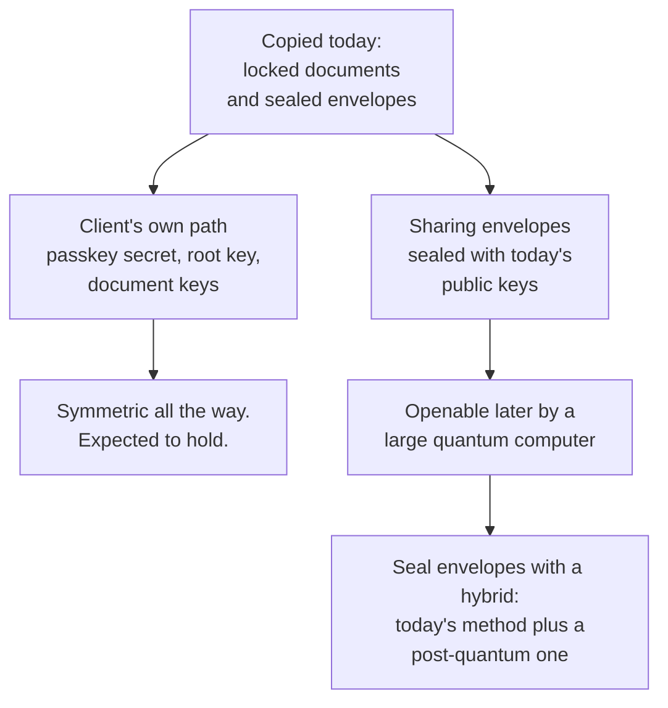

The damage is narrower than it sounds, thanks to the choice made back in Method 4.

- **The client's own path is symmetric end to end.** PRF output, HKDF, AES-256. The best known quantum attack on a symmetric cipher is Grover's algorithm, which halves the effective key length. AES-256 keeps 128 bits of security. A client who never shares has no public-key envelope to harvest.
- **The sharing envelopes are the exposed part.** A year key wrapped to an accountant's elliptic-curve public key is what a future quantum computer opens. Seal those with a hybrid of X25519 and ML-KEM, so an attacker has to break both.
- **Do it from day one.** Re-wrapping later protects what is in your database then. It does nothing for a copy taken before.
- **Label every wrapped key** with its algorithm and version, so the next migration is a background job and not a redesign.

<details>
<summary>What about signatures? Less urgent, two places to watch</summary>

Google calls quantum attacks on signatures "a future threat", because a forged signature only matters once the machine exists.

- **Login passkeys.** SimpleWebAuthn already accepts [ML-DSA passkeys](https://simplewebauthn.dev/docs/advanced/server/pqc-ml-dsa-support) at registration, on Node 24.7 or newer. The public keys are 20 to 40 times larger than P-256, so check the column type first. This changes how a passkey signs in. It has no effect on PRF or on anything encrypted.
- **Client-signed grants and closing manifests.** People need to believe these for years, so store them in a form you can re-sign under a newer algorithm.

</details>

## Side by side


<details>
<summary>The same comparison as a text table</summary>

| Method                                    | RCE on Rails reads documents? | Sharing                | Revocation      | Recovery                      | Server-side processing |
| ----------------------------------------- | ----------------------------- | ---------------------- | --------------- | ----------------------------- | ---------------------- |
| 1. KMS envelope, server decrypts          | **Yes, all of them**          | ACL row                | instant         | trivial                       | yes                    |
| 2. Password-derived key                   | No, but offline guessing      | needs Method 3         | n/a             | password reset loses data     | no                     |
| 3. Per-document DEK, wrapped per user     | No                            | wrap to public key     | delete + rotate | depends on key storage        | no                     |
| 4. Passkey PRF unlocks the key            | No, unless app JS is tampered | as Method 3            | as Method 3     | extra passkeys, recovery code | no                     |
| 5. Split origins, dedicated vault keypair | No, even with app JS tampered | as Method 3            | as Method 3     | extra passkeys, recovery code | no                     |
| 6. Recipient list, SOPS-style             | No                            | add recipient, re-wrap | remove + rotate | break-glass key               | no                     |
| 7. Attested enclave + KMS                 | No                            | ACL inside enclave     | instant         | operator-managed              | **yes**                |

</details>

## What I would build (or will build)


- **Method 5** for the keys. A login passkey on `app.example.com`, and a vault passkey with PRF on `vault.example.com`.
- The vault passkey's PRF output derives a KEK that wraps the client's symmetric root key, once per passkey and once under a recovery code.
- **Method 3** for storage and sharing, with the root, year and document hierarchy, and hybrid post-quantum envelopes for every share.
- The `sopsy` habits for membership. Out-of-band verification, client-signed recipient keys, an append-only signed grant log.
- Method 7 only if the product needs the server to read documents, and then for that one job.
- A KMS wrap around everything at rest, as a second layer and never the first.

If you are making this call for your own product, two questions get you most of the way.

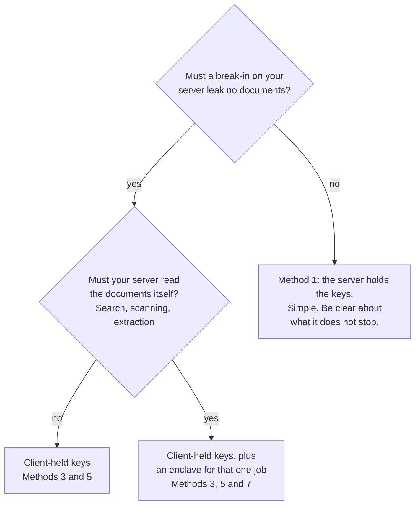

It comes back to the question from the top. "Is the data encrypted?" is the wrong thing to ask. Ask whose hands can decrypt it, and make sure your API server is not on the list.
